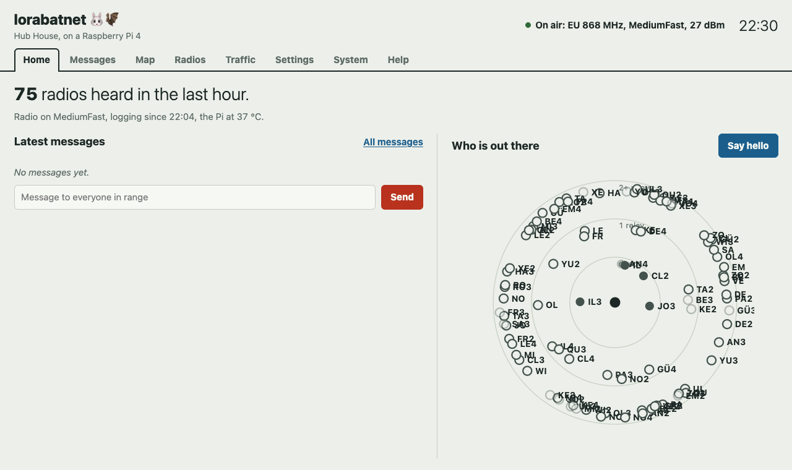
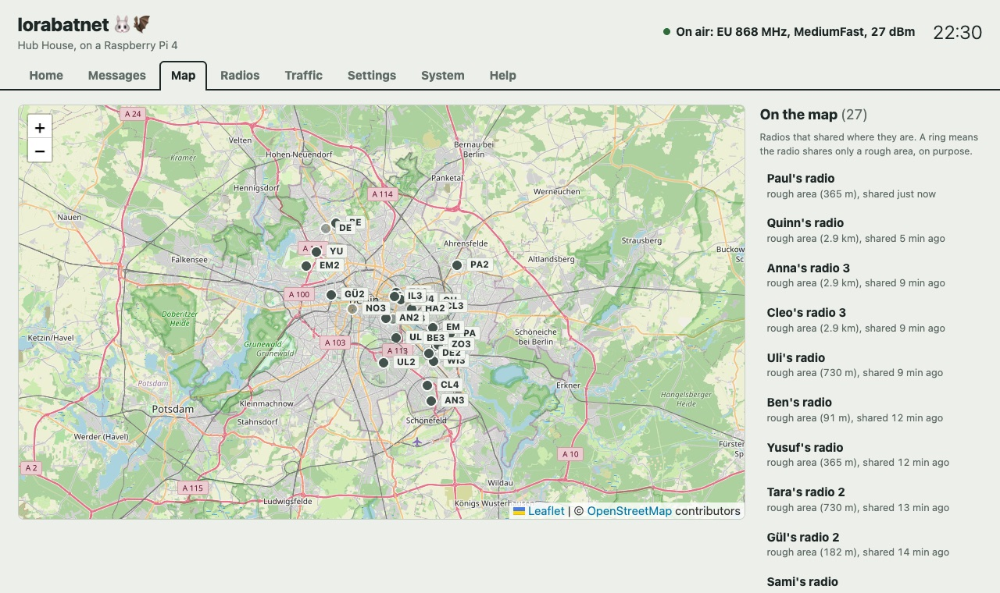
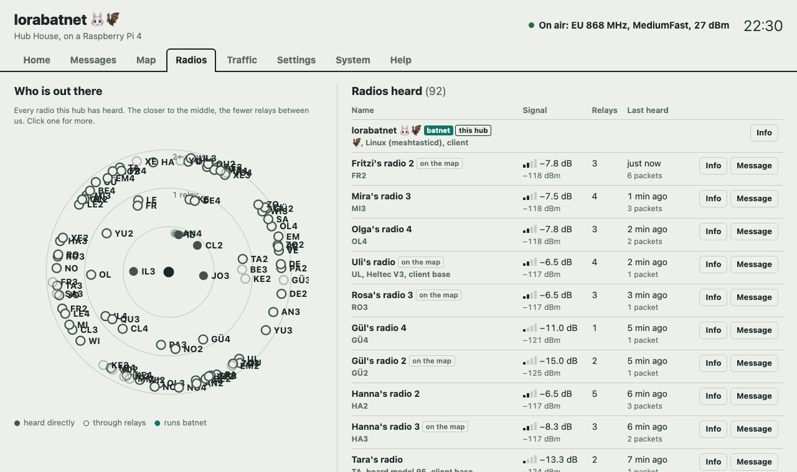
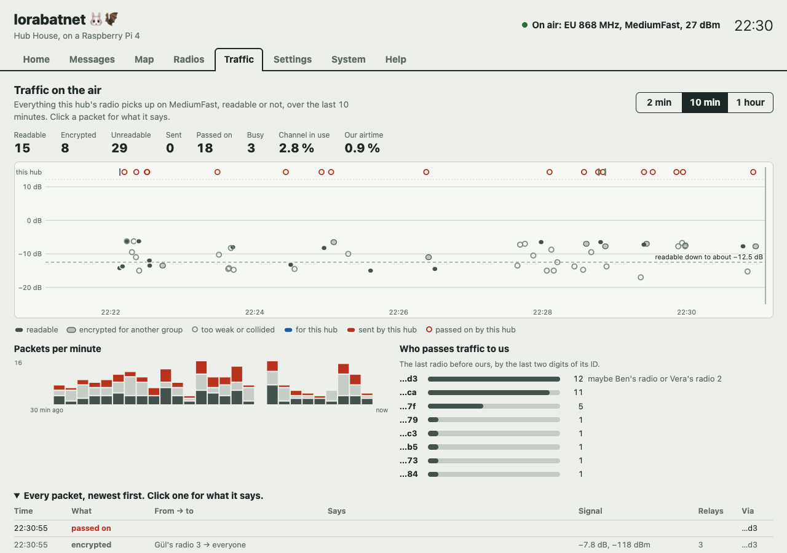
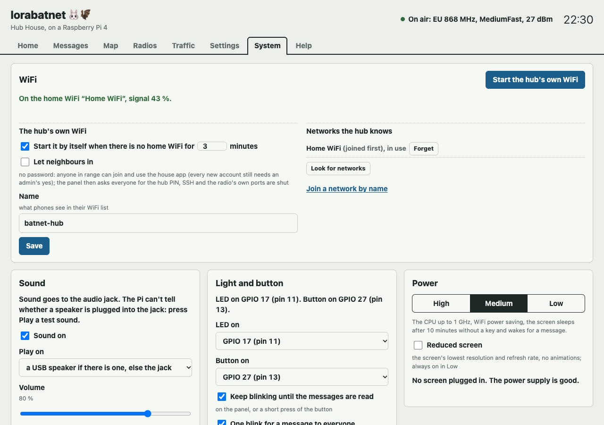
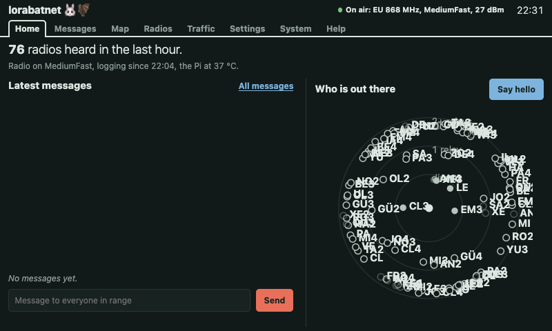

# batnet

**Chat with your neighbours when the phone network and the internet are down.**
Use any phone, tablet or laptop, in its web browser. There's no app to download
and no account with any company.

### [▶ Try the app and a pretend village in your browser](https://johnusher.github.io/batnet/)

### [🎬 Watch the film (five and a half minutes)](https://youtu.be/XyFXxIppOpI)

[](https://youtu.be/XyFXxIppOpI)

## A €45 box that keeps a street talking when the grid goes down

*When the power fails, the mobile masts can fall silent within hours. batnet, an
open-source project being tested in Berlin, turns a computer the size of a
bank card and a radio the size of a USB stick into a text network for a
street or a village. It needs no masts, no internet and no licence, and it
works out for itself which way it can hear.*

In September 2025 an arson attack on two pylons blacked out 50,000 Berlin
homes and businesses for two and a half days, and mobile coverage went
down with them. batnet is built for days like that. A small Raspberry Pi
computer in each house makes its own WiFi. Neighbours join it with any phone
and chat in the web browser, much like WhatsApp: no app to install, no
account with any company.

Houses link up by radio. Close neighbours, a few hundred metres apart, will
link over WiFi, which carries calls and photos too. Further out, a €25 radio
stick speaks **LoRa** ("long range"), the same radio used by the thousands of
hobbyist [Meshtastic](https://meshtastic.org/) radios on balconies and
church towers around the world. It is slow, about as fast as a 1980s modem,
and carries text only: each message holds about as much as a phone text
(SMS). But it goes far. From near the roof of a Berlin house, the first hub reads
a radio 12 km away with no help, and through radios that pass messages on,
up to seven in a row, it heard 154 radios across the city in one night.

The trick is in the signal. Every message is digital: a train of rising
whistles, or **chirps**, scrambled with a key and checked on arrival. A
receiver that knows the exact shape of a chirp can pick it out even when it
is fainter than the radio's own background hiss: up to about 50 times
fainter on the standard setting. (Bats hunt with chirps too, which suits a
project called batnet.)

Where it hears matters more than how loudly it shouts. With the antenna near
the roof, the hub picked up 26 radios in 20 minutes; brought indoors behind
a wall, it heard nothing for an hour. And it can tell which way it hears:
rather than assume a neat circle of range, the hub uses the strength of each
radio it hears to map its reach direction by direction.
[It turned out to be a narrow petal](#which-way-the-hub-hears-a-shape-not-a-circle),
pointing north-west.


> **Half built.** The app, the way nodes keep each other up to date, and the
> simulator are written and tested. Since October 2026
> [two real hubs](#the-first-hub-on-a-bench-in-berlin), first a Pi 4 and then
> a Pi Zero 2 W, have been on the air in Berlin, talking with
> [the city's long-range radio mesh](#berlins-long-range-radio-mesh-longfast-mediumfast-and-a-split-city)
> and with each other. The Zero runs there today, in a loft with its antenna
> on the roof. Houses don't share their messages with each other yet:
> that's next. There's no simple installer yet either. If you're happy typing
> commands, you can [build a hub today](#build-a-hub-today). To hear when
> batnet is ready for everyone, click **Watch** at the top of this page (you
> need a free GitHub account). New to words like *node*, *mesh* or *LoRa*?
> See [Words we use](#words-we-use).

## At a glance

| | |
|---|---|
| **What it is** | A local chat network for a house, a street, a village, a festival camp or a group on a hike. One small computer (a *node*) per house; everyone else just uses their phone. |
| **Range** | A few hundred metres from house to house over WiFi, with messages and calls. **1–3 km over the long-range radio** from house to house at ground level, much more from a roof: the first hub reads a radio **12 km away** directly. Messages also hop from radio to radio: in Berlin the first hub hears radios across 29 by 20 km of city, passed along by up to seven others. |
| **Which way** | Not a circle. The hub [maps its reach in each direction](#which-way-the-hub-hears-a-shape-not-a-circle) from the radios it hears: 15 km to the north-west for the first hub, unknown elsewhere. |
| **Messages** | Over the long-range radio, **text only, like an SMS**: up to 200 bytes in a packet, on the air for under half a second on Berlin's setting. Spoken messages are to cross as text, read aloud at the other end (planned). |
| **The mesh** | Every node passes on what it hears, so messages travel further than any one radio reaches, with no central server. batnet shares the air with Meshtastic's radios, and they carry its messages too, without being able to read the private ones. |
| **Legal** | **No licence needed in Europe**, in the slice from 869.4 to 869.65 MHz: at most half a watt, and on the air at most 10% of each hour. Our radio sends 0.16 W, about what a mobile phone sends; overnight in Berlin the hub used 1% of the hour while passing on 1,482 messages for others. [Is it legal?](#is-it-legal) |
| **Tested on** | A **Raspberry Pi 4** and a **Pi Zero 2 W**, each on the air in Berlin. Both took **200 phones at once** without an error ([measured](#which-raspberry-pi)); up to 100 phones, a message typically reached every phone in under a tenth of a second. |
| **Cost** | **From about €45**: a Pi Zero 2 W (€19) and the long-range radio (€25) make a pocket node. A house node that also links houses over WiFi is about **€150**. (EU prices, October 2026.) |
| **Power** | The Pi 4 hub ran **15 h 48 min on a 72 Wh power bank**, so it used at most about 4 W, like a small LED bulb. A pocket node should run about **1½ days on an ordinary 10,000 mAh power bank** (an estimate). Use a good 5 V, 3 A supply: the first hub's cheap one sagged when it worked hard. |
| **Antenna** | The biggest single factor. Up high and outside if you can: near the roof the hub heard 26 radios in 20 minutes, behind a wall none in an hour. |
| **Limits** | Long range is text only, and slow: a village shares roughly 100 to 600 radio messages an hour, depending on the setting. The Pi's own WiFi probably holds under 10 phones (not measured yet; a router holds many more). The app has no HTTPS yet, so on an open WiFi a neighbour with the know-how could read messages ([B50](knowledge/known-problems.md)). It doesn't replace the emergency services. |
| **Setup** | Our goal is **under 15 minutes** per node, from download to first message. Today a hub is set up with one command from a laptop, for people used to a terminal. |

## Where it helps

* **At home, when the power or the network fails** after a storm, a flood or a
  long blackout. Each house keeps in touch with the houses around it: *who needs
  medicine, where there is water, who has a running freezer.*
* **Festivals and big events,** such as Burning Man and Glastonbury, where the
  mobile network collapses under the crowd. Each camp carries a pocket node.
  Burning Man already has a
  [citywide network of these radios](https://www.burningmesh.org/).
* **Camping, hiking and expeditions** beyond mobile coverage.
* **Volunteers and community groups** running first aid, food or shelter
  points during an emergency.

## How it works

* **Every node makes its own WiFi network.** A node is a
  [Raspberry Pi](https://www.raspberrypi.com/): a computer about the size of a
  bank card. Join the node's WiFi, called something like "batnet · Miller
  House". There's no password, and a page opens on its own, like hotel WiFi.
* **The app runs in the web browser.** Any phone, tablet or laptop works,
  whether it's an iPhone, an Android or something else. Nothing to install.
* **It feels like WhatsApp.** There's a list of people in your house and in
  other houses, groups such as *Medical* and *Food*, and a channel for
  everyone. Houses within WiFi reach of each other can also make calls.
* **Nodes link up on their own.** Close ones (within a few hundred metres) link
  over WiFi. Far ones (1–3 km) link over a small long-range radio, called
  LoRa, added to the Pi. That radio carries text only. A spoken message is
  turned into text, sent, and read aloud at the other end.
  [How the radio works](#the-long-range-radio-explained).
* **Someone in each house approves new accounts,** so strangers can't join just
  by walking past.
* **It works with [Meshtastic](https://meshtastic.org/),** the popular
  long-range radio messenger. People with a Meshtastic radio see batnet's
  public posts and can reply, and their radios help carry batnet's messages
  further, without being able to read the private ones.
  [How batnet differs from Meshtastic](#how-batnet-differs-from-meshtastic-and-the-others).

## The first hub, on a bench in Berlin

On 21 October 2026 the first real batnet **hub** went on the air at home in
Berlin: a Raspberry Pi 4 with a USB long-range radio stick (an Elecrow
Meshstick, about €25). You use it on its own small screen and keyboard, or in
any web browser on the home WiFi. On 23 October a second hub, a Pi Zero 2 W,
joined it and the two radios messaged each other, but the hubs don't link
houses yet. The Zero then took over, in the loft with its antenna on the roof,
and the Pi 4 was switched off. The pictures here are from the Pi 4. A hub
listens to the [Meshtastic](https://meshtastic.org/)
radios around it, talks with them, and keeps going when the power and the
internet are gone.

[](docs/img/hub/home.png)

*Home, on an evening in October: 75 radios heard in the last hour, the latest
messages (none just then), and a radar of who is out there. The closer a dot is
to the middle, the fewer other radios passed its signal on before it reached
the hub.*

[](docs/img/hub/map.jpg)

*The map of Berlin: the radios that chose to share where they are. Berlin's
mesh reaches from the centre to the edge of the city, passed along by radios
on rooftops and towers. (The hub keeps the streets itself, so the map works
without the internet too: see [maps for a power cut](#maps-for-a-power-cut).)*

<table><tr>
<td width="50%"><a href="docs/img/hub/radios.png"></a><br><em>Radios: every radio heard, with its signal strength and how many relays it came through.</em></td>
<td width="50%"><a href="docs/img/hub/traffic.png"></a><br><em>Traffic: every packet on the air, even those too weak to read, and how busy the channel is.</em></td>
</tr><tr>
<td width="50%"><a href="docs/img/hub/system.png"></a><br><em>System: the hub's own WiFi for a power cut, sound, an LED and a button, and power modes.</em></td>
<td width="50%"><a href="docs/img/hub/screen.png"></a><br><em>The same panel on the hub's own small screen (800 × 480).</em></td>
</tr></table>

*In these pictures the radios' names, their numbers, the places and the words
of messages are swapped for made-up ones, because they belong to real people.
How many radios there are, their signal, their relays and the timing are real.*

**What the hub does today:**

* **Messages** to everyone nearby, to a group channel such as Berlin's
  BerlinMesh, or to one radio, with ticks when they
  arrive (✓ a radio passed it on, ✓✓ it got there).
* **A radar, a list and a map** of the radios around it, and a view of all the
  traffic on the air. Click any radio, packet or sender for what it says. The
  map shades where the hub should hear a radio directly, direction by
  direction, worked out from the signal of the radios it does hear directly
  ([not a circle](#which-way-the-hub-hears-a-shape-not-a-circle)).
* **Settings for the radio:** its speed setting (Berlin uses
  [*MediumFast*](#berlins-long-range-radio-mesh-longfast-mediumfast-and-a-split-city)),
  relays, power, listen-only and its name.
* **A log** of everything the radio hears, kept through power cuts, to take
  along on a walk or a bike ride.
* **For a power cut:**
  * **Its own WiFi.** When the home router is off, the hub makes a WiFi of its
    own after 3 minutes, or at once from a button. Phones join it with a QR
    code. It has a password, unless an admin chooses to let neighbours in.
  * **Power modes:** High, Medium and Low trade speed and screen time for
    battery life. The screen sleeps when nobody uses it, and only runs at all
    while one is plugged in.
  * **Sound and light:** a chime on a speaker for a new message, an LED that
    blinks until you read it, and a button to start the hub's own WiFi without
    a screen.
  * **A translator** between German and English, on the hub itself with no
    internet.
  * **Help** built in, and printable on paper: how long it runs on a power bank,
    what to do when something is wrong, and the commands to type.

**What we have tried on the real hub, and what not yet:**

| Tried and working | Not tried yet |
|---|---|
| The radio: it hears Berlin's mesh, sends, replies and passes other radios' messages on (1,482 in one night) | Two hubs sharing their houses' messages, over WiFi or over the radio |
| A second hub on a Pi Zero 2 W: its radio and the first hub's message each other | How many phones the hub's own WiFi holds at once |
| 200 pretend phones at once on each hub, in every power mode ([test](knowledge/tests/2026-10-23-hub-load-test.md)) | Many real phones over a whole day |
| Starting by itself after a power cut, and restarting itself after a crash (watchdogs) | A phone joining the hub's own WiFi, with the QR code and the page that pops up |
| Nearly 16 hours on a 72 Wh power bank, and an hour in a bag on a bike ride | The hub making its own WiFi by itself when the router is really off |
| Its own WiFi from the panel, with and without a password, and back to the home WiFi | The screen going to sleep and waking, and plugging a screen or keyboard in later |
| The power modes changing the processor's speed, WiFi power saving and the Pi's lights | The LED, the button and a speaker with real parts plugged in |
| The translator: about a second per message | How much power each mode saves (a USB power meter) |
| The Terminal button, and setting the hub's clock from a phone | The antenna outside on a cable |
| Offline maps of the area round the hub and four cities, drawn with the internet's map blocked | The map on the hub's own screen with the router really off |

The details are in the bench hubs' notes ([pi7](knowledge/hardware/bench-pi7.md),
[pz7](knowledge/hardware/bench-pz7.md)) and the [test reports](knowledge/tests/).

## Berlin's long-range radio mesh: LongFast, MediumFast and a split city

Berlin has a big, busy long-range radio mesh. Well over a hundred small
[Meshtastic](https://meshtastic.org/) radios sit on balconies, rooftops,
church towers and the Teufelsberg hill, run by neighbours, hobbyists and
groups such as Freifunk Berlin and the hackerspace c-base. Each one passes
on what it hears, so a message can cross the city with no internet and no
phone network. In one night our hub heard 154 of them. To hear them at all,
it had to be on the right **preset**.

### What a preset is

Every Meshtastic radio has a speed setting called a **preset**. It's like
choosing how slowly to speak across a noisy room. Speak slowly and people
further away can make you out, but each sentence takes longer and gets in
the way of everyone else. Speak quickly and you're done sooner, but only
people closer by follow you.

The presets have names like **LongFast** and **MediumFast**: *Long*,
*Medium* and *Short* say how far the radio tries to reach, *Fast* and *Slow*
fine-tune it. **LongFast is Meshtastic's standard**, and most of Europe uses
it. Under the bonnet, a preset sets how long each of LoRa's chirps lasts
([how chirps work](#how-lora-sends-a-message-chirps)). On LongFast one chirp
lasts 8.2 thousandths of a second. On MediumFast it lasts 2, a quarter as
long, so a message is on the air for little more than a quarter of the time:
about 0.4 seconds against 1.4. Each step slower adds a little reach (radio
people say 2.5 dB) and doubles the time on air.


### Radios on different presets can't hear each other

In Europe all the usual presets share **one frequency, 869.525 MHz**. You'd
think radios on the same frequency would at least hear each other. They
don't. A receiver listens for chirps of one exact length, and a chirp four
times shorter or longer slips past it unnoticed: not a word, not even noise
it can read. So a LongFast radio and a MediumFast radio side by side are
deaf to each other.

### Why Berlin moved to MediumFast

On LongFast, a busy city fills the air. Every message takes 1.4 seconds, and
every radio that hears it sends it on again, so messages run into each other
and both are lost. MediumFast's messages are on the air for about a quarter
of the time, so far fewer collide. In 2025 Berlin's Meshtastic users tested
both, and the big rooftop and tower repeaters of Freifunk Berlin and c-base
switched one by one to MediumFast. The community page of
[Berlin Chaos Mesh](https://potatomesh.net/pages/about) now gives MediumFast
as the city's setting. The price is a little less reach per hop, which a
dense city makes up for with more radios.

Not everyone moved. In 2025 people posted maps of a **divided city**,
MediumFast mostly in the west, north and centre, LongFast in parts of the
east and the south and around Potsdam. A visitor who arrives on LongFast,
the standard, hears almost no one and doesn't know why. Other German regions
chose differently again: Hessen, for example, is on ShortSlow.

### What our hub heard

On the evening of 21 October, with the antenna up near the roof, we
listened for 20 minutes on each preset, one after the other:

| | MediumFast | LongFast |
|---|---|---|
| Messages read | 30 | 8 |
| Different radios | 26 | 5 |
| Heard, but too garbled to read | 33 | 3 |

At this house MediumFast is where the mesh is, so the hub stayed on it. Then
we brought the antenna inside, behind a wall: in the next hour it heard
nothing at all. Near the roof the signals had been only just strong enough.
A wall took away the little margin there was.

Then the hub listened all night, from half past ten to a quarter past seven:

* **1,788 messages read from 154 radios.** The radios that shared where they
  are were spread over about 29 by 20 km: much of the city.
* **Almost everything came by relay.** Only 28 messages came straight from
  their sender, from 5 radios. Most were passed along by two, three or four
  other radios, and some by seven.
* **Berlin allows 7 hops.** Meshtastic's standard is 3, but three quarters
  of Berlin's radios let their messages be passed on up to 7 times, which is
  how they cross the city.
* **More was heard than read:** 2,788 messages were too garbled to read. A
  quarter of those were strong but had collided with another message; about
  half were too faint. A better antenna would rescue some of the faint ones.
* **The hub did its share.** It passed on 1,482 messages for others, while
  sending for only about 1% of each hour. The rules allow 10%.
* **It's quiet at night.** Two text messages in nearly nine hours. The rest
  was radios saying where they are, how full their battery is and what
  they're called.


### Which way the hub hears: a shape, not a circle

Ask how far a radio reaches and you usually get one number, say "15 km", as
if it reached that far in every direction. It doesn't. Hills, buildings and
the house it sits in shade it one way and leave it clear another. So the hub
works out its reach **direction by direction**, from what it actually hears.

Every radio that shares where it is, and reaches the hub with no relay in
between, tells the hub two things: how far away it is, and how much signal
it had to spare above the faintest the hub can read. A radio 12 km away
that arrives with 3 dB to spare could have been about 15 km away and still
got through. (Among houses a signal fades by about 30 dB each time the
distance grows tenfold, so 3 dB spare buys about a quarter more distance.)
The hub spreads each of these reaches over a narrow wedge, 30° either side
of the radio's direction, and joins them into a shape. Where no radio has
reached it straight, it draws nothing: not known yet, rather than a guess.


For the first hub the answer is a narrow petal pointing **north-west**. All
four radios it hears straight lie in that direction, 1 to 12 km away. Radios
to the north, the east and the south reach it only through relays, even one
just 3 km to the south. A circle drawn from the best reading would claim
about 717 km²; the readings support about 45 km², a sixteenth of that. The
antenna sits near the roof on one side of the house, so the house itself is
probably in the way of everything else. The fix is the same as ever: higher,
and outside.

The hub draws this shape live on its own map (the shaded zone, with a dashed
line to each radio behind it), and redraws it as it hears more. It is an
estimate: a radio lower down or indoors is heard less far than one up on a
roof like those it is based on. A radio counts only once the hub knows where
it is, and radios say that every few hours at most, so the hubs of a village
pass each other the places they have heard over the home network or the WiFi
mesh (sealed with the village's key; never by radio): a new hub draws its zone
in minutes, not days. The next step is a *range-test mode*, where
someone walks or cycles about with a radio that shares its place and the hub
fills in the shape from real measurements
([ideas](knowledge/ideas.md)). The sum is in
[`internal/hub/panel/panel.js`](internal/hub/panel/panel.js) (`coverage`).

### Joining Berlin's mesh with your own radio

* **Set the region to EU_868 and the preset to MediumFast.** In the
  Meshtastic app this is under the radio's LoRa settings. The public channel
  then works as it is; nothing else to set.
* **Put the antenna high, and outside if you can.** In Berlin most of what
  you hear comes in only just strong enough, through a few well-placed
  radios on roofs and towers.
* **Say hello where people talk:** Berlin Chaos Mesh's
  [page](https://potatomesh.net/pages/about), its Matrix room
  `#berlinmesh:c-base.org` and its forum, or Freifunk Berlin's meetup at c-base
  on the first Wednesday of the month.
* **Elsewhere,** ask the people nearby which preset they use. Never start a
  new one: a mesh split in two works worse for everyone.

batnet follows the same rule: a village's preset is a setting chosen from what
the neighbours use (LongFast where nothing says otherwise), and a hub can
listen on each preset in turn to find out
([draft decision 0027](knowledge/decisions/0027-preset-follows-the-local-mesh.md)).
The sources and the numbers are in
[presets in Berlin](knowledge/research/meshtastic-presets-berlin.md) and the
test reports for [the evening](knowledge/tests/2026-10-21-presets-and-antenna.md)
and [the night](knowledge/tests/2026-10-22-one-night-on-mediumfast.md).

## How batnet differs from Meshtastic and the others

batnet is not a rival to [Meshtastic](https://meshtastic.org/). Its long-range
radio runs Meshtastic, and batnet nodes and Meshtastic radios share the same
air. What batnet adds is everything around the radio, for a street or a
village rather than for one person with a gadget.

* **Nobody needs a radio or an app.** With Meshtastic, MeshCore or Reticulum,
  each person carries a small radio paired to an app on their phone. With
  batnet, one node per house or camp serves everyone's phone over open WiFi,
  in the browser. Nothing to buy per person, nothing to install.
* **Calls, voice and photos between nearby houses, not just text.** Houses
  within WiFi reach are linked by a WiFi mesh that carries anything the
  internet would. Meshtastic and MeshCore carry text only, at about a
  thousand bits a second. batnet uses the radio only for the houses that WiFi
  can't reach.
* **A community with a door.** People have accounts, someone in each house
  approves newcomers, and there's a directory of who is where and groups such
  as *Medical*. Meshtastic and MeshCore have channels: anyone who has the
  channel's key is in, and there's no directory and no approval.
* **Nothing is lost while a node is off.** Every batnet node keeps the whole
  history and fills in what it missed when it reconnects. A Meshtastic radio
  that was off misses what was sent. MeshCore's "room servers" and
  Reticulum's "propagation nodes" keep messages for people who were offline,
  but they are extra boxes someone has to set up. In batnet every node does it.
* **Spoken messages cross the radio as text.** Say it, the node turns it into
  text, and the far end reads it aloud. (Planned for milestone 2.)
* **It works with no phone at all.** A screen and keyboard on the node make it
  a household computer or a notice board in a village hall. The first hub
  already runs its panel this way, on a small screen of its own.
* **It shows who else is on the air.** A scan page lists Meshtastic radios,
  WiFi meshes and walkie-talkies nearby, by activity only, never content.
  (Planned for milestone 4. The first hub already shows every Meshtastic
  message on the air, even those too garbled to read.)

**The others, in a sentence each**

* **[Meshtastic](https://meshtastic.org/)** is the most popular long-range
  radio messenger, with by far the largest community. Every radio repeats what
  it hears, so a mesh builds itself.
  [How its messages hop](#how-messages-hop-meshtastic).
* **[MeshCore](https://meshcore.co.uk/)** is a newer messenger for the same
  radios. Instead of every radio repeating, a few *repeaters* placed on hills
  and roofs carry the traffic. That keeps the air quieter in a big mesh, but
  someone has to plan and site the repeaters.
* **[Reticulum](https://reticulum.network/)** is a network of its own, built
  on encryption, that runs over LoRa, WiFi, serial cables and the internet.
  Apps such as Sideband and MeshChat send messages and files over it. It is
  the most capable of the three and the most technical to set up. batnet may
  talk to it one day.
* **Phone-to-phone apps** such as [Briar](https://briarproject.org/) and
  [Bridgefy](https://bridgefy.me/) pass messages from phone to phone over
  Bluetooth or WiFi. Nothing to buy, but the reach is tens of metres, and
  everyone has to install the same app.

**Where batnet is weaker.** It's not finished: Meshtastic and MeshCore you
can buy and use today. Their radios run for days on a tiny battery, while a
batnet node is a small computer that needs a power bank or the mains. And a
batnet village needs someone to set up a node per house, where Meshtastic
needs only a radio per person.

## Ways to take part

| You have | What you can do |
|---|---|
| **Just a phone** | Join the nearest batnet WiFi and use everything: messages, groups, calls. |
| **A pocket node** (Pi Zero 2 W + radio + power bank) | Bring batnet to a camp, a hike or a small household. Its app takes far more phones than its own WiFi does (probably under 10), and it links to other nodes by radio, as text. |
| **A house node** (Pi 4 or 5) | Serve a whole household, link to neighbouring houses over WiFi, and add the radio to reach houses 1–3 km away. |
| **A Meshtastic radio** paired with your phone | Read and post on the public channel from anywhere in radio range, even with no node nearby. |

## What to buy (Europe)

To find each part, type the **article number** into the shop's search box.
Prices are from October 2026, include VAT and leave out shipping. Shops sell
out, so check before you order.

**A pocket node, about €45.** A Pi Zero 2 W and the long-range radio. It runs
on any USB power bank, and it is a Meshtastic radio too.

| Part | Shop | Article number | About |
|---|---|---|---|
| Raspberry Pi Zero 2 W | [Berrybase](https://www.berrybase.de/raspberry-pi-zero-2-w) | `RPIZ-2W` | €19 |
| RAK WisMesh Pi HAT (RAK6421) | [Hexaspot](https://hexaspot.com/products/wismesh-pi-hat-rak6421) | `RAK-610012` | €14 |
| + its radio module RAK13300, EU868, antenna included | [Hexaspot](https://hexaspot.com/products/module-for-lorawan-with-semtech-lora-chip-sx1262-rak13300) | `RAK-105006` | €10 |
| A [3D-printed case](#3d-printable-cases) | print your own, or ask a local makerspace | | €2 of plastic |

**A house node, about €150.** A bigger Pi, with room for a screen, the
translator and more maps ([which Pi](#which-raspberry-pi)), and a WiFi
stick that links it to the neighbours' nodes. Add the €25 radio above to reach
over the hills.

| Part | Shop | Article number | About |
|---|---|---|---|
| Raspberry Pi 5, 4 GB | [Berrybase](https://www.berrybase.de/raspberry-pi-5-4gb-ram) | `RPI5-4GB` | €119 |
| *or* Raspberry Pi 4 Model B, 4 GB | [Berrybase](https://www.berrybase.de/raspberry-pi-4-computer-modell-b-4gb-ram) | `RPI4B-4GB` | €106 |
| WiFi stick ALFA AWUS036ACHM, to link to other houses | [wlan-shop24](https://www.wlan-shop24.de/alfa-network-awus036achm-wlan-usb-adapter-802-11ac-dual-band) | `ART7230` | €43 |
| *or*, instead of the HAT: Elecrow Meshstick, the radio on a USB stick | [Berrybase](https://www.berrybase.de/elecrow-meshstick-usb-to-spi-sx1262-tcxo-lora-usb-stick-meshtastic-eu868-sma-22-dbm-5-v) | `EL-LMM15202D` | €25 |

**If you don't have them already:** a memory card (any 16 GB or bigger;
[SanDisk Ultra 32 GB](https://www.berrybase.de/sandisk-ultra-microsdhc-a1-120mb-s-class-10-speicherkarte-adapter-32gb),
`619659184155`, €18), a USB-C power supply for a house node
([27 W for a Pi 5](https://www.berrybase.de/raspberry-pi-27w-usb-c-power-supply-netzteil-weiss), `RPI5NT5AW`, €12;
[15 W for a Pi 4](https://www.berrybase.de/offizielles-raspberry-pi-usb-c-netzteil-5-1v-3-0a-eu-weiss), `RPI4NT3AW`, €8)
and a case ([Pi 5, with a fan](https://www.berrybase.de/offizielles-gehaeuse-fuer-raspberry-pi-5-rot-weiss), `RPI5-CASE-RE`, €10;
[Pi 4](https://www.berrybase.de/offizielles-gehaeuse-fuer-raspberry-pi-4-rot-weiss), `RPI4-CASE-RE`, €5).

**Optional extras, about €20–50:**

| Part | Shop | Article number | About | Why |
|---|---|---|---|---|
| USB sound card + 8 Ω speaker | [Berrybase](https://www.berrybase.de/waveshare-usb-sound-card-stereo-codec-mikrofon-lautsprecheranschluss-abtastraten-8-48khz) | `WS-18833` + `125171` | €15 | The house speaker that announces messages |
| Lit arcade button, 30 mm | [Berrybase](https://www.berrybase.de/detail/019234a4ff0e726490baff8fbad83dda) | `AB30L5-G` | €2 | Blinks for unread messages; press to hear them |
| USB GPS receiver | [Berrybase](https://www.berrybase.de/adafruit-ultimate-gps-mit-usb-66-channel-w-10-hz-updates) | `ADA4279` | €30 | Gives the whole village the right time, and the house's position |

**Don't buy these, they won't work:**
* **WiFi sticks with an MT7921 chip,** such as the ALFA AWUS036AXM and AXML.
  They can't link houses together.
* **Most cheap WiFi sticks.** These use Realtek chips, which need extra drivers.
* **The Waveshare "SX1262 LoRa HAT"** (Berrybase `RPI-868LORA`). It looks right,
  but it's the wrong type of board for this radio software.

Want a much longer WiFi link, 1–3 km between two houses? A pair of TP-Link
CPE210 outdoor units does it, about €42 each at
[reichelt](https://www.reichelt.de/de/de/shop/produkt/wlan_access_point_2_4_ghz_300_mbit_s_outdoor-150844).

## Installing

### Which Raspberry Pi?

We have tried two Pis as hubs: a **Pi 4** with 2 GB ("pi7", since 21 October
2026) and a **Pi Zero 2 W** with 512 MB ("pz7", since 23 October), drawn to
scale [at the top](#a-45-box-that-keeps-a-street-talking-when-the-grid-goes-down). Both have the
Elecrow Meshstick radio. The same set-up runs on both; a Pi with less than
1 GB gets no screen and no translator, as they need more memory than it has.

✅ tried and works · ❌ can't · ❔ not tried yet

| | Pi Zero 2 W | Pi 4 (2 GB) | Pi 5 | Pi 3 | Pi Zero W (the first) |
|---|---|---|---|---|---|
| The radio, the app and the control panel | ✅ | ✅ | ❔ should work | ❔ should work | ❌ the set-up needs a 64-bit Pi |
| 200 phones on the app at once ([test](knowledge/tests/2026-10-23-hub-load-test.md)) | ✅ | ✅ | ❔ | ❔ | ❌ |
| Its own WiFi for phones in a power cut | ❔ | ✅ (how many phones: ❔) | ❔ | ❔ | ❌ |
| A screen and keyboard on the hub | ❌ too little memory | ✅ | ❔ | ❌ too little memory | ❌ |
| The offline translator | ❌ too little memory | ✅ about 1 s a message | ❔ | ❌ | ❌ |
| Offline maps | ✅ all five areas, once the desktop is off an 8 GB card | ✅ | ❔ | ❔ | ❌ |
| Power modes (high, medium, low) | ✅ | ✅ | ❔ | ❔ | ❌ |
| Runs on a power bank | ❔ uses about a fifth of a Pi 4 | ✅ almost 16 h on 72 Wh | ❔ | ❔ | ❌ |
| Linking houses over WiFi | ❔ needs a USB WiFi stick and a USB hub | ❔ needs a USB WiFi stick | ❔ | ❔ | ❌ |
| The Pi's price ([what to buy](#what-to-buy-europe)) | €19 | €106 (4 GB) | €119 (4 GB) | | |

**In short:** a Pi Zero 2 W is a complete hub for a small household or a camp,
without a screen. Use the Lite version of Raspberry Pi OS on it: the desktop
version fills a small card and has to be removed again. Take a Pi 4 or 5 for a screen, the translator, or many maps.

<details>
<summary><b>The phone test in more detail</b></summary>

A laptop played up to 200 phones on the home WiFi. Every phone kept the app
open, looked at the Everyone conversation every 10 seconds and wrote in it
every 30 seconds. That is far busier than any real house: 200 such phones
send nearly 7 messages a second, and the hub hands out 1,300 a second. We ran
it on both Pis in each power mode. The full numbers are in the
[test report](knowledge/tests/2026-10-23-hub-load-test.md).

How long a message took to reach every phone (typical, and the slowest 5%), in
high power mode:

| Phones | Pi 4 | Pi Zero 2 W |
|---|---|---|
| 25 | 0.02 s, 0.03 s | 0.02 s, 0.08 s |
| 50 | 0.02 s, 0.1 s | 0.02 s, 0.06 s |
| 100 | 0.03 s, 0.13 s | 0.04 s, 0.09 s |
| 200 | 0.08 s, 1.2 s | 0.3 s, 0.7 s |

* **No errors** in any run, on either Pi, in any mode. A few messages (under
  2%) didn't show up live on a few phones at 100 to 200 phones; they show when
  the conversation is opened again ([B66](knowledge/known-problems.md)).
* **The processor is not the limit.** While chatting with 200 phones, the Zero's
  processor was on average less than a fifth busy, the Pi 4's under a tenth. At 200 phones the WiFi slowed
  things, not the Pi.
* **Low power mode is fine for messages.** It only slows signing up: 1.4 s on a
  Pi 4 and 2.8 s on a Zero, because the PIN is checked with deliberately slow
  maths that makes guessing it expensive.
* **Memory is the Zero's tightest part,** and it held: at least 149 MB of its
  416 MB stayed free.
* **The Pi 4's power supply was too weak** in high power mode: the Pi reported
  low voltage when two of its cores worked hard. Use a good 5 V, 3 A supply.
* **The real limit is the WiFi.** Here the home router carried the phones. In
  a power cut, phones join the hub's own WiFi from the Pi's built-in radio,
  and people report that it holds only about 6 to 8 phones. A battery-powered
  router or a separate access point holds many more. We haven't measured this
  yet.

</details>

### Build a hub today

This works now, but it's for people who are happy in a terminal. It turns a
Raspberry Pi into a hub like the one in Berlin: the radio, the panel, the
screen, the power-cut kit. It doesn't link houses yet.

**You need:** a Raspberry Pi 4 (2 GB is enough) or a Pi Zero 2 W, which works
too but without a screen or the translator ([which Pi](#which-raspberry-pi)),
the Elecrow Meshstick radio on USB (`EL-LMM15202D` in
[What to buy](#what-to-buy-europe); a Zero needs a micro-USB adapter), a memory
card, and a laptop with `git` and [Go](https://go.dev/dl/). A small HDMI screen
and a keyboard are nice but not needed. **Use a Pi you don't need for
anything else:** the set-up removes printing, Bluetooth, remote desktop and
other things a hub doesn't use.

1. **Put Raspberry Pi OS on the card** with
   [Raspberry Pi Imager](https://www.raspberrypi.com/software/): the 64-bit
   version (Debian 13, "trixie"); on a Pi Zero 2 W, the Lite one, without a
   desktop. In Imager's settings, give the Pi a name, your WiFi and SSH with
   your key.
2. **Screw the antenna onto the Meshstick first,** then plug it into the Pi
   and switch the Pi on.
3. **On the laptop:**
   ```sh
   git clone https://github.com/johnusher/batnet.git
   cd batnet
   deploy/pi/deploy.sh <your-pi>      # the name you gave it, as you'd type it after "ssh"
   ```
   This builds batnet for the Pi, copies it over and sets everything up. It is
   safe to run again.
4. **Set the radio's region,** once (the radio won't send until you do).
   Log in with `ssh <your-pi>` and type
   `meshtastic --host localhost --set lora.region EU_868`
   (and `--set-owner "a name"` to give the radio a name the others will see)
5. **Open `http://<your-pi>/hub/`** in a browser on the same WiFi. The PINs
   for the buttons are on the hub's own screen, or on the Pi with
   `sudo cat /var/lib/batnet/hub-pin /var/lib/batnet/admin-pin`. Under **Settings**, pick the
   preset your neighbours use: **MediumFast in Berlin**, LongFast in most
   other places ([why it matters](#berlins-long-range-radio-mesh-longfast-mediumfast-and-a-split-city)).

The [bench hub's notes](knowledge/hardware/bench-pi7.md) say what runs on it
and why, and the panel's **Help** tells you what to do in a power cut.

#### Maps for a power cut

The map's streets normally come from the internet. **A hub keeps its own
copy of the streets around it,** so the map still works when the router is
off. Nothing to do: once you mark where the hub stands (on the **Map**, *Mark
where this hub is*), it fetches the area around it, about 55 km across and
about 90 MB, the next time it has internet. Under **System, Offline maps**
you can also fetch **Berlin, London, Paris or Barcelona** with a button
(30 to 130 MB each), update a map, or remove it.

The maps are not in this repository: each hub fetches its own. They are cut
from [Protomaps](https://protomaps.com)' daily build of
[OpenStreetMap](https://www.openstreetmap.org/copyright) with the `pmtiles`
tool, which downloads only the area you ask for. OpenStreetMap's own map
server doesn't allow saving its pictures in bulk, so the hub never does that.
The map data is © OpenStreetMap contributors, under the Open Database
Licence. Why it works this way:
[decision 0032](knowledge/decisions/0032-offline-maps.md).

### The plan for the first release

These steps don't work yet. Choose one way:

#### Way 1: download and install (no GitHub account needed)

1. **Download one file:** *batnet.zip*. (The download link will appear here
   with the first release.)
2. **Unzip it** and double-click the installer for your computer:
   *Install on Windows* or *Install on Mac*. It opens the free
   [Raspberry Pi Imager](https://www.raspberrypi.com/software/) with batnet
   already chosen, and offers to download Imager first if you don't have it.
3. **Put the memory card in your computer,** pick it in Imager, and click
   **Write**. This takes about 5 minutes.
4. **Put the card in the Pi,** plug in the WiFi stick and the radio, and switch
   it on.
5. **On your phone, join the WiFi "batnet · setup".** A set-up page opens.
   Name your house (for example "Miller House") and create the first account,
   which approves everyone else.
6. **At the next house, do the same.** Nodes in range find each other by
   themselves.

#### Way 2: with GitHub, or on a Pi you already use

If your Pi already runs Raspberry Pi OS, one command will install batnet on it.
It will be published with the first release. Developers can clone this
repository instead: see [For developers](#for-developers).

#### Then, for everyone in the house

1. Join the WiFi **batnet · *your house name*** (no password).
2. A page pops up. Follow it to open your normal web browser.
3. **The browser shows a "not private" warning, once.** This is expected:
   without the internet, the node can't get the usual security certificate.
   The page shows you how to continue, and the connection is still encrypted.
4. Create an account and wait for your house's approver to let you in.

#### How you find out about new messages

Without the internet, a web page can't make a locked phone ring. So batnet
tells you in other ways:

* **Keep batnet open.** Your phone plays a sound for each new message, and
  vibrates on Android. Urgent messages are louder, and an alert from your
  house's approver sounds a siren.
* **Bedside mode.** At night, put the phone on charge and tap *Bedside mode* in
  Settings. The screen stays on, dimmed, so batnet can ring.
* **The house speaker.** Plug a small speaker into the house's Pi. It says who a
  message is for and who sent it ("Message for Ben, from Anna at Miller House"),
  never what it says, and only for people who switch this on. It stays quiet at
  night, except for urgent messages and alerts.
* **A button and a light on the Pi.** The light blinks while someone in the
  house has unread messages. Press the button to hear the announcements again.
* **Android phones, optional:** install the free
  [ntfy](https://ntfy.sh/) app *before* you need it. It can show real
  notifications from the house's Pi with no internet. iPhones can't do this.

## 3D-printable cases

Free designs that people have shared. Most are for non-commercial use: print
them for yourself, don't sell them. Pick one made for your radio board, because
boards that look alike differ in size.

* **Pocket node:**
  * [Pi Zero 2 W node with GPS](https://www.printables.com/model/909529-meshtastic-raspberry-pi-zero-2-w-based-node-with-g) (Waveshare radio board)
  * [base plate for a Pi Zero 2 W + RAK6421](https://www.printables.com/model/1750503-pi-zero-2w-rak6421-hat)
* **Pi plus a power bank:**
  [Rugged Case](https://www.printables.com/model/771172-rugged-case-for-raspberry-pi),
  which fits a Pi 4, Pi 3 or Zero 2 W with a 10,400 mAh battery. Drill a hole
  for the antenna.
* **House or field node:**
  * [Haven](https://www.printables.com/model/1468595-haven-case-for-raspberry-pi-based-manet-by-paralle) (Pi 4 with an antenna on top)
  * [Haven Node for Pi 5](https://www.printables.com/model/1578286-haven-node-raspberry-pi-5-double-antenna)
  * [openMANET Radio Case](https://makerworld.com/en/models/2128181-openmanet-radio-case), which has its own batteries
* **On a pole or a tent:**
  * [sealed mast-mount box for a Pi Zero 2 W](https://www.printables.com/model/1722952-meshtastic-enclosure-for-meshadv-pi-hat-on-raspber)
  * [radome on a painter's-pole thread](https://www.printables.com/model/301926-100mm-radome-for-meshtastictbeamrak-wisbocksdrrasp)

## Power use

Estimates from published measurements. On our own kit so far: the first hub
(a Pi 4, its radio, no screen) ran **15 h 48 min on a 72 Wh power bank**
until the bank gave out, so it used at most about 4 W on average. Nobody has
put a power meter on it yet, to see what each power mode saves. Details are in
[the power budget](knowledge/research/power-budget.md).

| Use case | Node | Energy a day | Runs on a 10,000 mAh power bank |
|---|---|---|---|
| Festival camp, 300 messages a day, all by radio | Pocket node (Pi Zero 2 W) | 18 Wh | about 1½ days |
| Relay on a pole, WiFi only | Pi Zero 2 W | 16 Wh | about 2 days |
| 5 houses on WiFi, 1,000 messages a day between them | House node (Pi 4), each | 84 Wh | about 8 hours |
| The same with 10,000 messages a day | House node (Pi 4), each | 84 Wh | about 8 hours |
| House with radio: 1,000 messages and 100 voice messages a day | House node (Pi 5) | 92 Wh | about 8 hours |

**The number of messages hardly matters.** A text over WiFi costs about a
thousandth of a joule. The computer's own idle draw sets the total, so a Pi
Zero 2 W uses about a fifth of what a Pi 4 or 5 does. Turning speech into text
is the only per-message cost worth counting. A house node wants mains power, a
car or leisure battery (about 300 Wh runs it 3–4 days), or a solar panel.
Phones run on their own batteries.

## The long-range radio, explained

The long-range radio lets houses 1–3 km apart reach each other when WiFi
can't. It is a small radio board on the Pi that uses **LoRa** (short for
"long range"): a way of sending data slowly, but very far, on very little
power. It runs **[Meshtastic](https://meshtastic.org/)**, free software that
turns these radios into a text messenger that passes messages on from radio to
radio.

| | |
|---|---|
| **Frequency** | 869.525 MHz, in the slice from 869.4 to 869.65 MHz (Europe) |
| **Licence** | None needed. Anyone may use this slice, within the rules below. |
| **Power** | Up to 0.5 watts allowed. Our radio sends at most 0.16 watts, about what a mobile phone sends. |
| **Time on air** | Each radio may send for at most 10% of the time: 6 minutes in every hour |
| **Speed** | About 1,000 bits a second on LongFast, 3,500 on MediumFast. A short text takes under a second to send. |
| **Range** | 1–3 km from house to house at ground level. Much more from a roof or a hill. |
| **Radio chip** | Semtech SX1262 |
| **Settings** | Whatever the neighbours use: Meshtastic's standard "LongFast" in most of Europe, "MediumFast" in Berlin ([what that means](#berlins-long-range-radio-mesh-longfast-mediumfast-and-a-split-city)) |

### Where it sits on the dial

Radio waves are measured in **hertz**: how many times a second the wave goes
up and down. One **megahertz (MHz)** is a million times a second. FM radio is
around 100 MHz and WiFi is around 2,400 MHz. batnet's long-range radio uses
869.5 MHz, where one wave is 34.5 cm long, nearly three times the length of a
WiFi wave. Longer waves travel further and get through walls and trees better.


Europe sets aside **863–870 MHz** for "short-range devices": anyone may send
on it without a licence, as long as they keep to the rules for each slice. Most
slices allow 25 milliwatts for 1% of the time. One narrow slice, **869.4–869.65
MHz**, allows twenty times the power and ten times the time on air. That's
where Meshtastic, and batnet, live.


### Sharing the band

Nobody owns these frequencies. Many kinds of device share them: sensors that
report a few bytes now and then, water and heat meters, alarm buttons, and
Meshtastic radios. The rules are what make sharing work: every radio speaks
briefly, then stays quiet. A Meshtastic radio also listens before it speaks,
and waits if someone else is talking.


This kind of picture is called a **waterfall**. Frequency runs across, time
runs down, and colour shows strength. It's how radio hobbyists watch the
airwaves. You can make your own with a cheap USB radio receiver (an
"RTL-SDR", about €30) and free software such as
[SDR++](https://www.sdrpp.org/). Here is a real recording of one Meshtastic
message, filling the whole 869.4–869.65 MHz slice:


<sub>A Meshtastic message on the "MediumFast" setting, by Tinux,
[CC0](https://commons.wikimedia.org/wiki/File:Meshtastic-spectrum-medium-fast.png),
Wikimedia Commons.</sub>

### How LoRa sends a message: chirps

LoRa sends data as **chirps**: a tone that slides up across the whole channel,
like a quick whistle going up. A message starts with a run of identical chirps
that say "a message is coming", then a few that mark the start. After that,
every chirp carries data, and **where a chirp starts** is the data. On
Meshtastic's LongFast setting, each chirp lasts 8.2 thousandths of a second
and can start at any of 2,048 places, so each chirp carries 11 bits.


A receiver knows exactly what shape to look for, so it can pick out a chirp
even when it is **fainter than the background hiss** of the radio. That's
where LoRa's range comes from. The price is speed: about 1,000 bits a second
on LongFast, slower than a 1990s dial-up modem. Slower settings (a higher
"spreading factor") reach further still, and faster ones reach less far. Bats
hunt with chirps too: many species call with a sweep of pitch and listen for
the echo.

### How messages hop: Meshtastic

* **Every radio repeats what it hears,** once. When a radio hears a message
  it hasn't seen before, it waits a moment and sends it again, so messages
  travel beyond the reach of any single radio.
* **The furthest radios repeat first.** A radio that heard the message only
  faintly is probably far from the sender, so it waits the shortest time. The
  others hear it repeat and stay quiet, which saves airtime.
* **A message makes at most 3 hops** by default. Each message carries a
  counter that drops by one at each hop. The sender can allow up to 7, and in
  Berlin most do: the first hub hears messages that crossed the city through
  seven radios.
* **Messages are scrambled** (encrypted, with AES). Meshtastic's public channel
  uses a key everyone knows, so anyone can read it. batnet's private channel
  uses a key only the village has. Meshtastic radios carry it along all the
  same, without being able to read it.
* **The airtime is small, so batnet packs it.** With 6 minutes an hour per
  radio, a village can send roughly 100–200 batnet messages an hour over the
  radio on LongFast, and about three times as many on MediumFast. That's plenty for text, and far too little for voice, which is why
  spoken messages go as text.

### Antennas

The antenna matters more than anything else you buy. A good antenna, mounted
high, can easily double the range.


* **Get an antenna for 868 MHz.** Antennas are cut for one frequency. A 433
  MHz or 2.4 GHz antenna won't work.
* **Never switch the radio on without its antenna.** Sending into nothing can
  damage the radio chip.
* **Stand it upright.** Radios hear each other best when their antennas point
  the same way, and Meshtastic radios are upright by convention.
* **Higher is better.** Outside the window beats inside, and the roof beats
  the window. Some modern window glass has a thin metal coating that blocks
  radio.
* **Keep the cable short.** Thin cable (RG174) loses about half the signal
  every 3 metres at this frequency. For a long run to the roof, use thick
  low-loss cable, or put the radio up by the antenna, as on this roof.
* **Check the plug.** Most radios use SMA plugs. "RP-SMA" plugs look the same
  but don't connect. Small boards often have a tiny "u.FL" socket and a short
  adapter cable.

<sub>A solar-powered Meshtastic node on a roof in Germany, by -stk,
[CC BY-SA 4.0](https://commons.wikimedia.org/wiki/File:2025-10_Meshtastic_Node_temporaerhaus_P1090106.jpg),
Wikimedia Commons.</sub>

<br clear="right">

**Antenna gain** (measured in **dBi**) is not extra power. An antenna can't
make power. It changes the shape of where the signal goes. A tall antenna with
more gain squeezes the signal into a flatter disc, so it reaches further over
flat land but less up to a hilltop or down into a valley.


### How far it reaches

Range depends far more on **height** and **what's in the way** than on power.
At 869 MHz, radio travels in straight lines. Hills, concrete, metal and wet
leaves weaken or block it. Wooden houses and glass let most of it through.


The signal doesn't travel along a thin line from one antenna to the other. It
fills a fat, cigar-shaped zone around that line (the **Fresnel zone**). Halfway
along a 2 km link it is 13 metres deep, so trees and roofs well below the
straight line still get in the way. That's why a few metres of height beat
extra power.


The Earth's curve sets a limit too. Two antennas 2 metres off flat ground can
see each other up to about 12 km apart; at 10 metres, about 26 km. The
Meshtastic record is **331 km**, between mountaintops in northern Italy and
Slovenia, on the slowest setting with good antennas.

### Is it legal?

**In Europe, yes, without a licence, if you keep to the rules.** The rules come
from CEPT, which coordinates radio between 46 European countries (including
the UK and Switzerland), and each country's radio regulator publishes them
(in Germany, the Bundesnetzagentur). For 869.4–869.65 MHz:

* **At most 500 milliwatts**, counted after the antenna's gain ("ERP",
  effective radiated power). Our radio sends at most 160 mW. With the antenna
  in the box that comes to about 150 mW, and even with a 6 dBi antenna it is
  about 390 mW. With a bigger antenna, turn the radio's power down.
* **On the air at most 10% of the time,** counted over each hour. Meshtastic
  keeps to this by itself when its region is set to **EU_868**. Don't switch
  on its "override duty cycle" setting.
* **Set the right region.** A radio set up for America (915 MHz) would send on
  frequencies used by mobile phone networks and other services in Europe.
* **Buy radios made for the EU 868 MHz band,** with a CE mark.
* **Encryption is allowed** here. It isn't on amateur ("ham") radio bands.

People with an **amateur radio licence** can switch Meshtastic to "ham mode"
for more power and other bands, but then encryption must be off and the radio
must send their call sign. batnet's private channel needs encryption, so batnet
stays in the licence-free slice.

**Elsewhere,** the rules and frequencies differ: the Americas use 902–928 MHz,
for example. Meshtastic's region setting picks the right ones. batnet is being
built and tested in Europe first.

*This is a plain-words summary, not legal advice. Rules change, so check your
own country's radio regulator.*

### A short history

* **1947:** at an international radio conference in Atlantic City, countries
  set aside "ISM" bands (industrial, scientific and medical) for machines like
  microwave heaters, which spray radio noise. Nobody needed a licence to use
  them. 2.4 GHz, today's WiFi band, is one of them.
* **1950s:** radar engineers start sending chirps, which let a weak radar see
  further.
* **1985:** America allows anyone to send "spread spectrum" signals in the ISM
  bands without a licence. This leads to WiFi, Bluetooth and, later, LoRa in
  America's 902–928 MHz band.
* **1997:** Europe gathers its rules for licence-free short-range devices into
  one rule book (CEPT's ERC Recommendation 70-03). Its 863–870 MHz band is
  Europe's counterpart to America's 902–928 MHz, which is why European LoRa
  radios are "868 MHz" radios and American ones "915 MHz".
* **2012:** Semtech, an American chip maker, buys Cycleo, a small company in
  Grenoble, France, that had built a long-range chirp radio for smart meters.
  Semtech names it LoRa.
* **2015:** the LoRa Alliance forms to agree a common way (LoRaWAN) for
  sensors to report to the internet.
* **2020:** Kevin Hester starts Meshtastic, a LoRa messenger for hikers and
  paragliders.

<details>
<summary><b>For radio hobbyists: the numbers</b></summary>

**LongFast on EU_868** (Meshtastic's defaults; Berlin's MediumFast differs only in spreading factor 9, a 2.048 ms symbol, 3.52 kbit/s and a 148 dB link budget):

| | |
|---|---|
| Centre frequency | 869.525 MHz (slot 1 of 1 in EU_868) |
| Bandwidth | 250 kHz |
| Spreading factor | 11 (2,048 chips per symbol; symbol time 8.192 ms) |
| Coding rate | 4/5 |
| Preamble | 16 symbols (Meshtastic lengthens LoRa's usual 8) |
| Sync word | `0x2B` |
| Raw data rate | 1.07 kbit/s |
| Link budget | 153 dB at 22 dBm and a 0 dBi antenna (Meshtastic's figure) |
| Hop limit | 3 (up to 7) |

**Time on air** for one packet, header and CRC on (the standard LoRa airtime
formula): 60 bytes ≈ 0.68 s, 100 bytes ≈ 1.0 s, 150 bytes ≈ 1.4 s. The 10%
limit gives each radio 360 s an hour. Every repeat costs airtime again.

**Other EU presets.** The 500 kHz "Turbo" presets aren't allowed in EU_868.

| Preset | SF | Bandwidth | Data rate | Link budget |
|---|---|---|---|---|
| Short Fast | 7 | 250 kHz | 10.94 kbit/s | 143 dB |
| Short Slow | 8 | 250 kHz | 6.25 kbit/s | 145.5 dB |
| Medium Fast | 9 | 250 kHz | 3.52 kbit/s | 148 dB |
| Medium Slow | 10 | 250 kHz | 1.95 kbit/s | 150.5 dB |
| **Long Fast** | **11** | **250 kHz** | **1.07 kbit/s** | **153 dB** |
| Long Moderate | 11 | 125 kHz | 0.34 kbit/s | 156 dB |

**Useful formulas** (d in km, f in MHz unless noted, h in metres):

* Free-space path loss: `FSPL(dB) = 20·log10(d) + 20·log10(f) + 32.44`. At
  869.5 MHz, 10 km is 111 dB, so a 153 dB budget would span over 1,000 km in
  empty space. On the ground, terrain sets the limit, not power. Each 6 dB
  more doubles free-space range.
* Radio horizon over smooth ground: `d ≈ 4.12·(√h1 + √h2)`.
* First Fresnel zone radius at the middle: `r ≈ 8.66·√(d / f_GHz)` metres. At
  2 km and 0.8695 GHz, 13.1 m; keep about 60% of it clear.
* ERP from what the radio sends: `ERP(dBm) = P(dBm) + G(dBi) − cable loss(dB) − 2.15`.
  The limit is 27 dBm ERP (500 mW). A 22 dBm radio stays legal up to about
  7 dBi plus your cable loss.
* Quarter wave at 869.5 MHz: 299.8 / 869.5 / 4 = 8.6 cm; cut the radiator a
  little shorter (about 8.2 cm) for end effect, then trim against a NanoVNA.

#### How a receiver reads a chirp

If the data is where a chirp starts, why not just send a beep at that
frequency? Against plain noise a beep would do about as well. In fact, the
receiver turns every chirp back into a beep before reading it. The slide is
there for everything else that goes wrong on a real radio: interference,
echoes and cheap crystals. Here's how.

To keep the numbers simple, measure frequencies from the bottom of the
channel, so it runs from 0 to 250 kHz. On LongFast a chirp climbs about
**30.5 kHz every millisecond**, and the 2,048 possible starting points are
**122 Hz apart**. The value 500 starts 500 × 122 Hz = **61 kHz** up.


**Step 1: multiply by a falling chirp, and the slide disappears.** Multiplying
two signals (what radio people call mixing) gives a tone at the difference
between them. Musicians hear this when two notes slightly out of tune make a
slow wobble. The receiver makes its own chirp that falls 30.5 kHz every
millisecond, the exact opposite of the incoming one, and mixes the two:

| Time | Incoming chirp | Receiver's falling chirp | What's left |
|---|---|---|---|
| 0 ms | 61 kHz | 0 kHz | **61 kHz** |
| 2 ms | 122 kHz | −61 kHz | **61 kHz** |
| 4 ms | 183 kHz | −122 kHz | **61 kHz** |
| 6 ms | 244 kHz | −183 kHz | **61 kHz** |

The slide cancels out. What's left is a **steady 61 kHz tone** for the whole
symbol: the chirp has become a beep, and where it started is now its pitch.

<sub>The wrap at the top doesn't break this. After about 6.2 ms the chirp
jumps from 250 kHz back to 0, so the leftover tone jumps by exactly 250 kHz.
The receiver takes exactly 250,000 samples a second, and at that rate a jump of
exactly 250 kHz is invisible, like a wheel that turns one whole turn between
film frames and seems to stand still.</sub>

**Step 2: 2,048 narrow detectors, each listening to the whole symbol.**
During one symbol the receiver takes 2,048 samples (250,000 a second ×
8.192 ms). A Fourier transform (the fast version, the **FFT**) asks of those
samples 2,048 questions at once: how much 0 Hz is there, how much 122 Hz, how
much 244 Hz, and so on. It's like shouting a note into a piano with the
sustain pedal down: only the string tuned to that note keeps ringing.
Detector 500 lights up, and the value is 500.

**Why it works below the noise.** In the right detector, all 2,048 samples
of the tone line up and add: the tone grows 2,048 times. Noise is random, so
its samples partly cancel and it grows only about √2,048 ≈ 45 times. The right
detector stands out by a factor of 2,048 in power, about **33 dB**. A LongFast
signal 17.5 dB *below* the noise (about the limit Semtech gives for spreading
factor 11) stands about 15 dB *above* the noise in its own detector.

**Why not watch one frequency and time when the chirp passes?** Each chirp
crosses every frequency once, so in principle one detector and a stopwatch
could decode it. But a detector parked on one frequency hears the chirp for
only a moment, so it collects a sliver of its energy: fine for a loud signal,
useless below the noise. And telling 2,048 values apart means timing the
crossing to about 4 millionths of a second. To react that fast, a detector
has to listen about 250 kHz wide, which is the whole channel. Step 1 avoids
both problems by turning *when* into *what pitch*, so each detector can
listen narrow and long.

**The bonus: interference gets scattered.** A steady beep from another
gadget goes through the same multiplication and comes out as a falling chirp
(the bottom row above). A chirp isn't one pitch, so the FFT spreads its
energy thinly over all 2,048 detectors: it raises each one a little and
swamps none. The same step that gathers the wanted chirp into one detector
scatters the interferer across all of them. Echoes are separated the same
way: a late copy of the chirp has already slid on, so it lands in a
neighbouring detector instead of cancelling the direct signal.

**Finding the start.** The receiver has to line its 8.2 ms window up with the
chirps, but it doesn't have to catch the start precisely first:

* **A late window just looks like a different value.** On a chirp, *later*
  and *higher* are the same thing. A window 10 samples late puts every peak
  10 detectors up. Once the receiver knows the "10", it subtracts it.
* **The preamble finds it without any timing.** The message starts with a
  run of identical rising chirps carrying the value 0. Any 2,048-sample window
  laid over a run of identical chirps holds exactly one full turn of the
  sweep, wherever it starts. So the receiver cuts the air into windows blindly
  and watches for several in a row that peak in the same detector: a message
  is coming. If they peak in detector 10, its window is 10 samples late.
* **The falling chirps separate timing from a cheap crystal.** A crystal that
  is slightly off also shifts the peak, because a higher frequency looks like
  a higher value. So "detector 10" could be lateness, crystal error, or both.
  The two falling chirps in the start mark settle it: lateness moves their
  peak *down* while crystal error still moves it *up*. Rising chirps measure
  lateness + crystal, falling chirps measure crystal − lateness: two sums,
  two unknowns.


After that the receiver is within a fraction of a sample. What's left splits
the peak between two neighbouring detectors and costs a few dB at worst; the
chip trims it by comparing the two, and keeps tracking drift through a long
message.

**What it costs.** Run one by one, 2,048 detectors over 2,048 samples would
take about 4 million multiplications per symbol. The FFT does it in about
2,048 × 11 ≈ 22,500 steps, small enough for a cheap radio chip to manage every
8 ms.

**Listening.** An RTL-SDR tuned to 869.525 MHz shows Meshtastic traffic on a
waterfall. Watching activity is fine. Some countries, Germany included,
restrict recording or passing on the content of transmissions not meant for
you, which is why batnet's own scanner reports activity only
([decision 0009](knowledge/decisions/0009-scanner-activity-only.md)).

**Sources and more detail:** [EU868 radio basics](knowledge/research/eu868-radio-basics.md),
[LoRa airtime in EU868](knowledge/research/lora-airtime-eu868.md),
[radio links compared](knowledge/research/radio-links-compared.md),
[LoRa radios](knowledge/hardware/lora-radios.md). The diagrams are drawn by
[`docs/img/radio/make.py`](docs/img/radio/make.py).

</details>

## Words we use

### batnet's own words

| Word | What it means |
|---|---|
| **House** | A household on batnet: the people who share one node, plus that node. It has a name, such as "Miller House", which is also the name of its WiFi. A house doesn't have to be a building. It can be a flat, a camp at a festival or a group on a hike. |
| **Node** | One of batnet's small computers (a Raspberry Pi) running batnet. Every node keeps a copy of all the village's messages. |
| **House node** | The node a house uses: a Pi 4 or Pi 5 at home on mains power. It makes the house's WiFi, runs the app for the whole house (200 phones in a test), and links to the houses around it. |
| **Hub** | A house node with its own control panel (on `/hub/` in the browser, or on a small screen of its own): the radio's settings, the radios around it, the traffic on the air, and the power-cut kit. The first one has been running in Berlin since October 2026. |
| **Pocket node** | A small node (a Pi Zero 2 W) with the long-range radio, running on a power bank. For a camp, a hike or a small household. Its own WiFi probably holds under 10 phones. |
| **Relay** | A node that serves no phones. It sits on a pole or a roof between two houses that are too far apart to reach each other over WiFi, and passes messages between them. |
| **Gateway** | Any node with the long-range radio fitted. It carries messages to and from houses too far away for WiFi. |
| **Village** | All the houses that share one village key and so can talk to each other, whether by WiFi or by radio. One village might be a street, a hamlet or a festival. |
| **Village key** | The one secret that a whole village shares. It locks every message that travels between nodes, so outsiders can't read them. A new house gets it by scanning a QR code on an approver's phone. |
| **WiFi group** | The houses that are linked to each other over WiFi right now. A village can be split into several WiFi groups, joined to each other by the long-range radio. |
| **Approver** (or **admin**) | The person in each house who lets new people in. The first account made on a house's node is its approver. |
| **Everyone channel** | One chat that every person in the village can read and post in. |
| **Groups** | Chats for a purpose, such as *Medical*, *Food*, *Water* or *Childcare*. |
| **Neighbourhood (public)** | The chat on the open Meshtastic channel. Anyone nearby with a Meshtastic radio can read it, even people who aren't on batnet, so the app warns you before you post there. |
| **Priority** | How urgent a message is: *Low*, *Normal* or *High*. High goes first over the radio. An approver can also send an **Alert**, which shows at the top of every phone. |
| **Voice message** | A spoken message. Over WiFi it travels as sound. Over the long-range radio it's turned into text, sent, and read aloud by the phone at the other end. |
| **House speaker** | An optional speaker on the house's node that says who a message is for and who sent it, never what it says. |
| **Bedside mode** | A setting that keeps your phone's screen on, dimmed, so batnet can ring you at night. |
| **No-phone mode** (planned) | A screen and keyboard plugged into the house's node, for people without a phone. It's a shared screen where people sign in, or a notice board that shows alerts and the everyone channel. |

### Technical words

| Word | What it means |
|---|---|
| **Raspberry Pi** | A cheap computer about the size of a bank card, made in the UK. "Pi 4", "Pi 5" and "Pi Zero 2 W" are different models. |
| **Memory card** | The small card (microSD) that holds the Pi's software, like a phone's storage. You put batnet on it from your own computer. |
| **WiFi stick** (dongle) | A WiFi radio that plugs into a USB socket. A house node uses its own WiFi to serve phones and the stick to link to other houses. |
| **HAT** | A board that plugs onto the pins on top of a Pi, like a hat. batnet's long-range radio can come as a HAT. |
| **Hotspot** | A WiFi network that a device makes for phones to join, as a phone does when it shares its internet. Each node makes one, with no internet behind it. |
| **Sign-in page** (captive portal) | The page that pops up by itself when you join a hotel's or café's WiFi. batnet uses it to welcome you. |
| **"Not private" warning** | What a browser shows when a website's security certificate can't be checked. Without the internet a node can't get the usual certificate, so you see this warning once. The connection is still encrypted. |
| **Mesh** | A network with no centre, in which each device passes messages on for the others. If one drops out, messages find another way. |
| **batman-adv** | The free software that links nodes into a WiFi mesh. It's built into Linux. |
| **LoRa** | Short for *long range*: a radio that sends small amounts of data over 1–3 km or more using very little power. It's too slow for sound or pictures, so batnet uses it only for text. |
| **Meshtastic** | A popular free messenger for LoRa radios. batnet's radio runs Meshtastic, so batnet works with other people's Meshtastic radios. |
| **MeshCore** | Another free messenger for the same LoRa radios, which routes messages through planned repeaters instead of every radio repeating. [How batnet differs](#how-batnet-differs-from-meshtastic-and-the-others). |
| **Reticulum** | A network of its own, built on encryption, that runs over LoRa, WiFi, cables and the internet. Apps such as Sideband send messages over it. |
| **Preset** | A Meshtastic radio's speed setting, such as *LongFast* (the standard) or *MediumFast* (Berlin's). Slower presets reach a little further; faster ones keep the air freer. Radios on different presets can't hear each other. [More](#berlins-long-range-radio-mesh-longfast-mediumfast-and-a-split-city). |
| **Spreading factor** (SF) | The number behind a preset: how long each LoRa chirp lasts. Each step up doubles the chirp's length and the time a message takes. LongFast is SF 11, MediumFast SF 9. |
| **Hop** | One radio passing a message on to the next. A Meshtastic message carries a limit on its hops: 3 by default, up to 7. (Not the same as a batnet *relay*, which is a node on a pole that serves no phones.) |
| **Channel** | A conversation on the radio that only radios with the same key can read. batnet uses a private channel for its own messages and the open public one for *Neighbourhood (public)*. |
| **EU868** | The radio band around 868 MHz that anyone in Europe may use without a licence. |
| **Duty cycle** (airtime) | The share of each hour a radio may transmit in the EU868 band: 10% in the part batnet uses. When a busy radio reaches its limit, messages wait in a queue, which is why urgent ones go first. |
| **dBi** | How much an antenna concentrates its signal in one direction, compared with an imaginary antenna that sends equally in every direction. More dBi doesn't mean more power: the antenna squeezes the same power into a flatter shape, so it reaches further across flat land but less up and down. The antenna that comes with the radio is about 2 dBi. |
| **ERP** (effective radiated power) | How strong a radio's signal really is once the antenna's gain is added and the cable's losses are taken away. The legal limit in the part of the band batnet uses is 500 milliwatts ERP, so a bigger antenna can mean turning the radio's power down. |
| **Fresnel zone** | The fat, cigar-shaped space around the straight line between two antennas that the signal fills as it travels. Trees or roofs inside it weaken the signal even if they don't block the straight line, which is why raising an antenna by a few metres helps so much. |
| **Waterfall** | A picture of radio signals over time: frequency runs across, time runs down, and colour shows how strong each signal is. Radio hobbyists use it to watch which radios are on the air. |
| **Speech-to-text** | Software that turns a spoken message into written words. It runs on the node, not on the internet. |
| **Encryption** | Scrambling a message so that only someone with the right key can read it. |
| **Heartbeat** | A short note that each node sends its direct neighbours every few seconds: "here's what I have". A node that has missed something notices and asks for it. |
| **Sync** | How nodes catch up with each other. When a node comes back after a power cut, it fetches the messages it missed. |
| **Simulator** | The [pretend village](https://johnusher.github.io/batnet/) that runs in your web browser, to show and test a whole village of batnet houses before there are enough real ones. |

Developers: the full list of technical terms is in
[the knowledge glossary](knowledge/glossary.md).

---

## The film

**[Watch the film on YouTube](https://youtu.be/XyFXxIppOpI)** (five and a half
minutes): a Berlin blackout on the real map, how a house node works, why it
has two radios and what it costs, the questions people ask, Glastonbury with a
lost child and a bang that everyone reports, the simulator that runs the real
code, and the first two real hubs on the air in Berlin: 154 radios heard in
one night across 29 km of city, the farthest 25 km away. The narrator's German
accent is part of the act. The film is made from code in
[`video/`](video/), so it can be re-cut as batnet changes; every number in it
comes from the repo or the public record.

## Try the simulator

[](https://johnusher.github.io/batnet/)
[](https://johnusher.github.io/batnet/)

**[Open the simulator](https://johnusher.github.io/batnet/)**: a pretend village
that runs entirely in your web browser.

* **See the app through anyone's phone:** joining, signing up, chatting, the
  list of people in reach, or a neighbour's Meshtastic app.
* **Watch messages travel** between houses over WiFi and over the long-range
  radio.
* **Change the village:** more houses, bigger households, fewer radios. You can
  also cut a house's power and watch what still gets through.

**Two engines.** *Model* is a quick JavaScript model of the whole system.
*Real batnet code* runs batnet's actual Go code for every house, compiled for
the browser, through prepared scenarios such as *bang* (everyone hears a bang
and posts at once) and *storm* (houses lose power and catch up). It covers the
WiFi mesh and the long-range radio (with Meshtastic users relaying).

**A real phone in the real engine.** Pick a house and a person, and the phone
beside the map runs the real batnet app, talking to that house's real server.
Post something, let the village run a minute, then switch to someone at another
house to see it arrive. Choose *New visitor* to ask to join, then switch to the
house's admin to let them in.

[](https://johnusher.github.io/batnet/)

To run it offline (the *Model* engine only):
1. Click the green **Code** button at the top of this page, then
   **Download ZIP**.
2. Unzip it, open the folder `prototypes`, then `village-sim`.
3. Double-click `index.html`.

The *Real batnet code* engine needs to be built first; developers, see below.

The numbers in the simulator come from a model, not from real radios. What
we've learned from it is in
[the simulator findings](knowledge/research/village-sim-findings.md).

---

## For developers

The project's research, decisions and hardware notes are in
[`knowledge/`](knowledge/). Start with the [vision](knowledge/vision.md), the
[decisions](knowledge/decisions/) and the
[EU shopping list](knowledge/hardware/shopping-list-eu.md). The knowledge is
stored as an
[Open Knowledge Format](https://github.com/GoogleCloudPlatform/knowledge-catalog/blob/main/okf/SPEC.md)
bundle, which both people and coding agents can read. Instructions for agents
are in [AGENTS.md](AGENTS.md).

**Set up a clone.** You need `git`, [Go](https://go.dev/dl/) 1.26 or newer, and
[gitleaks](https://github.com/gitleaks/gitleaks#installing):

```sh
git clone https://github.com/johnusher/batnet.git
cd batnet
git config core.hooksPath .githooks          # secret scan + knowledge check on every commit
go test ./...                                 # run the tests
go run ./cmd/batnetd -mock 5 -loss 0.3        # a pretend village of 5 houses on this computer
go run ./cmd/batnetd -sim scenarios/*.json    # village scenarios with the real code, judged pass/fail
go run ./cmd/batnetd -mock 3 -web -for 0      # three houses, each serving the real app on 127.0.0.1:8001-8003
sh prototypes/village-sim/build-site.sh _site  # build the simulator with the real engine
(cd _site && python3 -m http.server)          # then open http://localhost:8000
(cd tools/okflint && go run . ../../knowledge) # check the knowledge bundle by hand
```

This repository is public, so never commit keys, passwords, real names or
precise locations. See [secret hygiene](knowledge/security/secret-hygiene.md).

**Licence:** [MIT](LICENSE). You're free to use, copy, change and share batnet.
