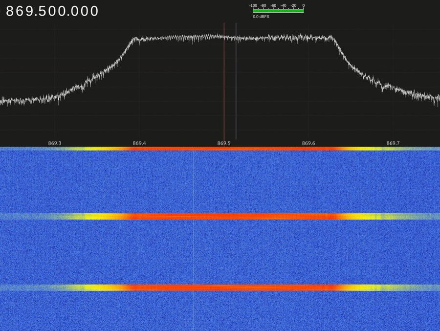
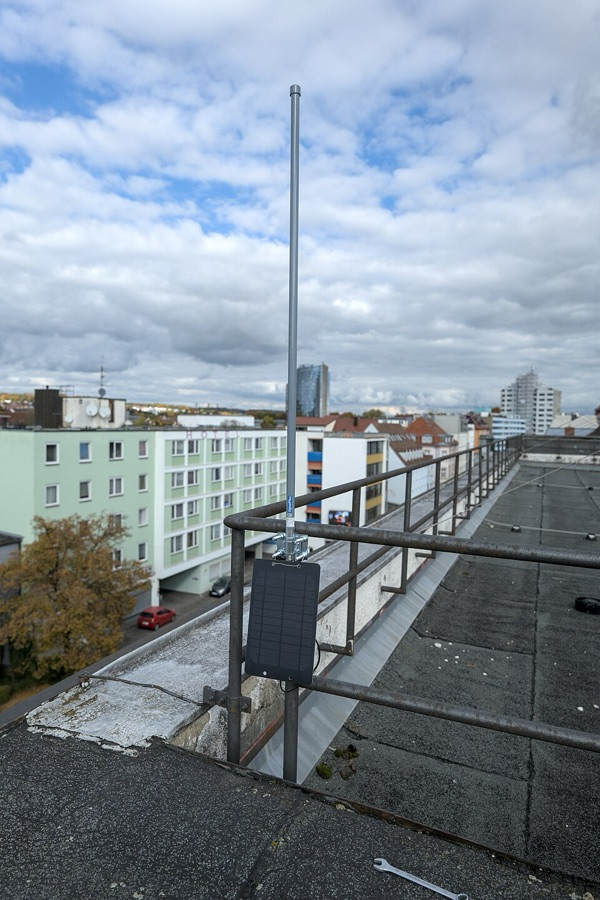
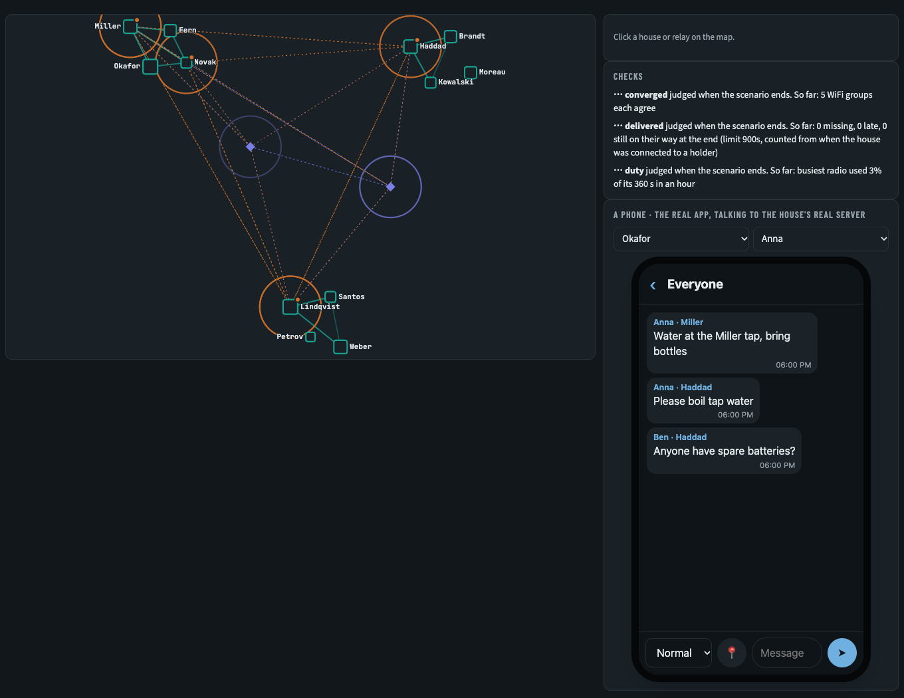

# batnet

**Chat with your neighbours when the phone network and the internet are down.**
Use any phone, tablet or laptop, in its web browser. There's no app to download
and no account with any company.

### [▶ Try the app and a pretend village in your browser](https://johnusher.github.io/batnet/)

### [🎬 Watch the film (five minutes)](https://youtu.be/zk5At_n8p_c)

[](https://youtu.be/zk5At_n8p_c)

[Watch on YouTube](https://youtu.be/zk5At_n8p_c) · [Download the MP4](https://github.com/johnusher/batnet/raw/film/batnet.mp4) (1080p, 43 MB)

batnet turns small, cheap computers into a local chat network for a house, a
street, a village, a festival camp or a group on a hike. New to words like
*node*, *mesh* or *LoRa*? See [Words we use](#words-we-use).

> **Not ready yet.** batnet is still being designed, so there's nothing to
> install today. The link above shows how the app will look and work. To hear
> when it's ready, click **Watch** at the top of this page (you need a free
> GitHub account).

## At a glance

| | |
|---|---|
| **Range** | A few hundred metres from house to house over WiFi, with messages and calls. **1–3 km over the long-range radio**, text only. |
| **People** | About **60 phones** on a Pi 5 node, 40 on a Pi 4, 8 on a pocket Pi Zero 2 W. These are estimates, not measured yet. |
| **Cost** | **From about €45**: a Pi Zero 2 W (€19) and the long-range radio (€25) make a pocket node. A house node that also links houses over WiFi is about **€150**. (EU prices, October 2026.) |
| **Power** | A pocket node runs about **1½ days on an ordinary 10,000 mAh power bank**. A house node uses about as much as a 4 W LED bulb left on all day. These are estimates. |
| **Setup** | Our goal is **under 15 minutes** per node, from download to first message. |

## Where it helps

* **At home, when the power or the network fails** after a storm, a flood or a
  long blackout. Each house keeps in touch with the houses around it: *who needs
  medicine, where there is water, who has a running freezer.*
* **Festivals and big events,** such as Burning Man and Glastonbury, where the
  mobile network collapses under the crowd. Each camp carries a pocket node.
  Burning Man already has a
  [citywide network of these radios](https://www.burningmesh.org/).
* **Camping, hiking and expeditions** beyond mobile coverage.
* **Volunteers and community groups** running first aid, food or shelter
  points during an emergency.

## How it works

* **Every node makes its own WiFi network.** A node is a
  [Raspberry Pi](https://www.raspberrypi.com/): a computer about the size of a
  bank card. Join the node's WiFi, called something like "batnet · Miller
  House". There's no password, and a page opens on its own, like hotel WiFi.
* **The app runs in the web browser.** Any phone, tablet or laptop works,
  whether it's an iPhone, an Android or something else. Nothing to install.
* **It feels like WhatsApp.** There's a list of people in your house and in
  other houses, groups such as *Medical* and *Food*, and a channel for
  everyone. Houses within WiFi reach of each other can also make calls.
* **Nodes link up on their own.** Close ones (within a few hundred metres) link
  over WiFi. Far ones (1–3 km) link over a small long-range radio, called
  LoRa, added to the Pi. That radio carries text only. A spoken message is
  turned into text, sent, and read aloud at the other end.
  [How the radio works](#the-long-range-radio-explained).
* **Someone in each house approves new accounts,** so strangers can't join just
  by walking past.
* **It works with [Meshtastic](https://meshtastic.org/),** the popular
  long-range radio messenger. People with a Meshtastic radio see batnet's
  public posts and can reply, and their radios help carry batnet's messages
  further, without being able to read the private ones.

## Ways to take part

| You have | What you can do |
|---|---|
| **Just a phone** | Join the nearest batnet WiFi and use everything: messages, groups, calls. |
| **A pocket node** (Pi Zero 2 W + radio + power bank) | Bring batnet to a camp, a hike or a small household. It serves about 8 phones and links to other nodes by radio, as text. |
| **A house node** (Pi 4 or 5) | Serve a whole household, link to neighbouring houses over WiFi, and add the radio to reach houses 1–3 km away. |
| **A Meshtastic radio** paired with your phone | Read and post on the public channel from anywhere in radio range, even with no node nearby. |

## What to buy (Europe)

To find each part, type the **article number** into the shop's search box.
Prices are from October 2026, include VAT and leave out shipping. Shops sell
out, so check before you order.

**A pocket node, about €45.** A Pi Zero 2 W and the long-range radio. It runs
on any USB power bank, and it is a Meshtastic radio too.

| Part | Shop | Article number | About |
|---|---|---|---|
| Raspberry Pi Zero 2 W | [Berrybase](https://www.berrybase.de/raspberry-pi-zero-2-w) | `RPIZ-2W` | €19 |
| RAK WisMesh Pi HAT (RAK6421) | [Hexaspot](https://hexaspot.com/products/wismesh-pi-hat-rak6421) | `RAK-610012` | €14 |
| + its radio module RAK13300, EU868, antenna included | [Hexaspot](https://hexaspot.com/products/module-for-lorawan-with-semtech-lora-chip-sx1262-rak13300) | `RAK-105006` | €10 |
| A [3D-printed case](#3d-printable-cases) | print your own, or ask a local makerspace | | €2 of plastic |

**A house node, about €150.** A bigger Pi, for about 60 phones, and a WiFi
stick that links it to the neighbours' nodes. Add the €25 radio above to reach
over the hills.

| Part | Shop | Article number | About |
|---|---|---|---|
| Raspberry Pi 5, 4 GB | [Berrybase](https://www.berrybase.de/raspberry-pi-5-4gb-ram) | `RPI5-4GB` | €119 |
| *or* Raspberry Pi 4 Model B, 4 GB | [Berrybase](https://www.berrybase.de/raspberry-pi-4-computer-modell-b-4gb-ram) | `RPI4B-4GB` | €106 |
| WiFi stick ALFA AWUS036ACHM, to link to other houses | [wlan-shop24](https://www.wlan-shop24.de/alfa-network-awus036achm-wlan-usb-adapter-802-11ac-dual-band) | `ART7230` | €43 |
| *or*, instead of the HAT: Elecrow Meshstick, the radio on a USB stick | [Berrybase](https://www.berrybase.de/elecrow-meshstick-usb-to-spi-sx1262-tcxo-lora-usb-stick-meshtastic-eu868-sma-22-dbm-5-v) | `EL-LMM15202D` | €25 |

**If you don't have them already:** a memory card (any 16 GB or bigger;
[SanDisk Ultra 32 GB](https://www.berrybase.de/sandisk-ultra-microsdhc-a1-120mb-s-class-10-speicherkarte-adapter-32gb),
`619659184155`, €18), a USB-C power supply for a house node
([27 W for a Pi 5](https://www.berrybase.de/raspberry-pi-27w-usb-c-power-supply-netzteil-weiss), `RPI5NT5AW`, €12;
[15 W for a Pi 4](https://www.berrybase.de/offizielles-raspberry-pi-usb-c-netzteil-5-1v-3-0a-eu-weiss), `RPI4NT3AW`, €8)
and a case ([Pi 5, with a fan](https://www.berrybase.de/offizielles-gehaeuse-fuer-raspberry-pi-5-rot-weiss), `RPI5-CASE-RE`, €10;
[Pi 4](https://www.berrybase.de/offizielles-gehaeuse-fuer-raspberry-pi-4-rot-weiss), `RPI4-CASE-RE`, €5).

**Optional extras, about €20–50:**

| Part | Shop | Article number | About | Why |
|---|---|---|---|---|
| USB sound card + 8 Ω speaker | [Berrybase](https://www.berrybase.de/waveshare-usb-sound-card-stereo-codec-mikrofon-lautsprecheranschluss-abtastraten-8-48khz) | `WS-18833` + `125171` | €15 | The house speaker that announces messages |
| Lit arcade button, 30 mm | [Berrybase](https://www.berrybase.de/detail/019234a4ff0e726490baff8fbad83dda) | `AB30L5-G` | €2 | Blinks for unread messages; press to hear them |
| USB GPS receiver | [Berrybase](https://www.berrybase.de/adafruit-ultimate-gps-mit-usb-66-channel-w-10-hz-updates) | `ADA4279` | €30 | Gives the whole village the right time, and the house's position |

**Don't buy these, they won't work:**
* **WiFi sticks with an MT7921 chip,** such as the ALFA AWUS036AXM and AXML.
  They can't link houses together.
* **Most cheap WiFi sticks.** These use Realtek chips, which need extra drivers.
* **The Waveshare "SX1262 LoRa HAT"** (Berrybase `RPI-868LORA`). It looks right,
  but it's the wrong type of board for this radio software.

Want a much longer WiFi link, 1–3 km between two houses? A pair of TP-Link
CPE210 outdoor units does it, about €42 each at
[reichelt](https://www.reichelt.de/de/de/shop/produkt/wlan_access_point_2_4_ghz_300_mbit_s_outdoor-150844).

## Installing

These steps are the plan for the first release and don't work yet. Choose one
way:

### Way 1: download and install (no GitHub account needed)

1. **Download one file:** *batnet.zip*. (The download link will appear here
   with the first release.)
2. **Unzip it** and double-click the installer for your computer:
   *Install on Windows* or *Install on Mac*. It opens the free
   [Raspberry Pi Imager](https://www.raspberrypi.com/software/) with batnet
   already chosen, and offers to download Imager first if you don't have it.
3. **Put the memory card in your computer,** pick it in Imager, and click
   **Write**. This takes about 5 minutes.
4. **Put the card in the Pi,** plug in the WiFi stick and the radio, and switch
   it on.
5. **On your phone, join the WiFi "batnet · setup".** A set-up page opens.
   Name your house (for example "Miller House") and create the first account,
   which approves everyone else.
6. **At the next house, do the same.** Nodes in range find each other by
   themselves.

### Way 2: with GitHub, or on a Pi you already use

If your Pi already runs Raspberry Pi OS, one command will install batnet on it.
It will be published with the first release. Developers can clone this
repository instead: see [For developers](#for-developers).

### Then, for everyone in the house

1. Join the WiFi **batnet · *your house name*** (no password).
2. A page pops up. Follow it to open your normal web browser.
3. **The browser shows a "not private" warning, once.** This is expected:
   without the internet, the node can't get the usual security certificate.
   The page shows you how to continue, and the connection is still encrypted.
4. Create an account and wait for your house's approver to let you in.

### How you find out about new messages

Without the internet, a web page can't make a locked phone ring. So batnet
tells you in other ways:

* **Keep batnet open.** Your phone plays a sound for each new message, and
  vibrates on Android. Urgent messages are louder, and an alert from your
  house's approver sounds a siren.
* **Bedside mode.** At night, put the phone on charge and tap *Bedside mode* in
  Settings. The screen stays on, dimmed, so batnet can ring.
* **The house speaker.** Plug a small speaker into the house's Pi. It says who a
  message is for and who sent it ("Message for Ben, from Anna at Miller House"),
  never what it says, and only for people who switch this on. It stays quiet at
  night, except for urgent messages and alerts.
* **A button and a light on the Pi.** The light blinks while someone in the
  house has unread messages. Press the button to hear the announcements again.
* **Android phones, optional:** install the free
  [ntfy](https://ntfy.sh/) app *before* you need it. It can show real
  notifications from the house's Pi with no internet. iPhones can't do this.

## 3D-printable cases

Free designs that people have shared. Most are for non-commercial use: print
them for yourself, don't sell them. Pick one made for your radio board, because
boards that look alike differ in size.

* **Pocket node:**
  * [Pi Zero 2 W node with GPS](https://www.printables.com/model/909529-meshtastic-raspberry-pi-zero-2-w-based-node-with-g) (Waveshare radio board)
  * [base plate for a Pi Zero 2 W + RAK6421](https://www.printables.com/model/1750503-pi-zero-2w-rak6421-hat)
* **Pi plus a power bank:**
  [Rugged Case](https://www.printables.com/model/771172-rugged-case-for-raspberry-pi),
  which fits a Pi 4, Pi 3 or Zero 2 W with a 10,400 mAh battery. Drill a hole
  for the antenna.
* **House or field node:**
  * [Haven](https://www.printables.com/model/1468595-haven-case-for-raspberry-pi-based-manet-by-paralle) (Pi 4 with an antenna on top)
  * [Haven Node for Pi 5](https://www.printables.com/model/1578286-haven-node-raspberry-pi-5-double-antenna)
  * [openMANET Radio Case](https://makerworld.com/en/models/2128181-openmanet-radio-case), which has its own batteries
* **On a pole or a tent:**
  * [sealed mast-mount box for a Pi Zero 2 W](https://www.printables.com/model/1722952-meshtastic-enclosure-for-meshadv-pi-hat-on-raspber)
  * [radome on a painter's-pole thread](https://www.printables.com/model/301926-100mm-radome-for-meshtastictbeamrak-wisbocksdrrasp)

## Power use

Estimates from published measurements, not yet tested on our own kit. Details
are in [the power budget](knowledge/research/power-budget.md).

| Use case | Node | Energy a day | Runs on a 10,000 mAh power bank |
|---|---|---|---|
| Festival camp, 300 messages a day, all by radio | Pocket node (Pi Zero 2 W) | 18 Wh | about 1½ days |
| Relay on a pole, WiFi only | Pi Zero 2 W | 16 Wh | about 2 days |
| 5 houses on WiFi, 1,000 messages a day between them | House node (Pi 4), each | 84 Wh | about 8 hours |
| The same with 10,000 messages a day | House node (Pi 4), each | 84 Wh | about 8 hours |
| House with radio: 1,000 messages and 100 voice messages a day | House node (Pi 5) | 92 Wh | about 8 hours |

**The number of messages hardly matters.** A text over WiFi costs about a
thousandth of a joule. The computer's own idle draw sets the total, so a Pi
Zero 2 W uses about a fifth of what a Pi 4 or 5 does. Turning speech into text
is the only per-message cost worth counting. A house node wants mains power, a
car or leisure battery (about 300 Wh runs it 3–4 days), or a solar panel.
Phones run on their own batteries.

## The long-range radio, explained

The long-range radio lets houses 1–3 km apart reach each other when WiFi
can't. It is a small radio board on the Pi that uses **LoRa** (short for
"long range"): a way of sending data slowly, but very far, on very little
power. It runs **[Meshtastic](https://meshtastic.org/)**, free software that
turns these radios into a text messenger that passes messages on from radio to
radio.

| | |
|---|---|
| **Frequency** | 869.525 MHz, in the slice from 869.4 to 869.65 MHz (Europe) |
| **Licence** | None needed. Anyone may use this slice, within the rules below. |
| **Power** | Up to 0.5 watts allowed. Our radio sends at most 0.16 watts, about what a mobile phone sends. |
| **Time on air** | Each radio may send for at most 10% of the time: 6 minutes in every hour |
| **Speed** | About 1,000 bits a second. A short text takes about half a second to send. |
| **Range** | 1–3 km from house to house at ground level. Much more from a roof or a hill. |
| **Radio chip** | Semtech SX1262 |
| **Settings** | Meshtastic's standard "LongFast": spreading factor 11, 250 kHz wide |

### Where it sits on the dial

Radio waves are measured in **hertz**: how many times a second the wave goes
up and down. One **megahertz (MHz)** is a million times a second. FM radio is
around 100 MHz and WiFi is around 2,400 MHz. batnet's long-range radio uses
869.5 MHz, where one wave is 34.5 cm long, nearly three times the length of a
WiFi wave. Longer waves travel further and get through walls and trees better.


Europe sets aside **863–870 MHz** for "short-range devices": anyone may send
on it without a licence, as long as they keep to the rules for each slice. Most
slices allow 25 milliwatts for 1% of the time. One narrow slice, **869.4–869.65
MHz**, allows twenty times the power and ten times the time on air. That's
where Meshtastic, and batnet, live.


### Sharing the band

Nobody owns these frequencies. Many kinds of device share them: sensors that
report a few bytes now and then, water and heat meters, alarm buttons, and
Meshtastic radios. The rules are what make sharing work: every radio speaks
briefly, then stays quiet. A Meshtastic radio also listens before it speaks,
and waits if someone else is talking.


This kind of picture is called a **waterfall**. Frequency runs across, time
runs down, and colour shows strength. It's how radio hobbyists watch the
airwaves. You can make your own with a cheap USB radio receiver (an
"RTL-SDR", about €30) and free software such as
[SDR++](https://www.sdrpp.org/). Here is a real recording of one Meshtastic
message, filling the whole 869.4–869.65 MHz slice:



<sub>A Meshtastic message on the "MediumFast" setting, by Tinux,
[CC0](https://commons.wikimedia.org/wiki/File:Meshtastic-spectrum-medium-fast.png),
Wikimedia Commons.</sub>

### How LoRa sends a message: chirps

LoRa sends data as **chirps**: a tone that slides up across the whole channel,
like a quick whistle going up. A message starts with a run of identical chirps
that say "a message is coming", then a few that mark the start. After that,
every chirp carries data, and **where a chirp starts** is the data. On
Meshtastic's LongFast setting, each chirp lasts 8.2 thousandths of a second
and can start at any of 2,048 places, so each chirp carries 11 bits.


A receiver knows exactly what shape to look for, so it can pick out a chirp
even when it is **fainter than the background hiss** of the radio. That's
where LoRa's range comes from. The price is speed: about 1,000 bits a second
on LongFast, slower than a 1990s dial-up modem. Slower settings (a higher
"spreading factor") reach further still, and faster ones reach less far. Bats
hunt with chirps too: many species call with a sweep of pitch and listen for
the echo.

### How messages hop: Meshtastic

* **Every radio repeats what it hears,** once. When a radio hears a message
  it hasn't seen before, it waits a moment and sends it again, so messages
  travel beyond the reach of any single radio.
* **The furthest radios repeat first.** A radio that heard the message only
  faintly is probably far from the sender, so it waits the shortest time. The
  others hear it repeat and stay quiet, which saves airtime.
* **A message makes at most 3 hops** by default. Each message carries a
  counter that drops by one at each hop.
* **Messages are scrambled** (encrypted, with AES). Meshtastic's public channel
  uses a key everyone knows, so anyone can read it. batnet's private channel
  uses a key only the village has. Meshtastic radios carry it along all the
  same, without being able to read it.
* **The airtime is small, so batnet packs it.** With 6 minutes an hour per
  radio, a village can send roughly 100–200 batnet messages an hour over the
  radio. That's plenty for text, and far too little for voice, which is why
  spoken messages go as text.

### Antennas

The antenna matters more than anything else you buy. A good antenna, mounted
high, can easily double the range.



* **Get an antenna for 868 MHz.** Antennas are cut for one frequency. A 433
  MHz or 2.4 GHz antenna won't work.
* **Never switch the radio on without its antenna.** Sending into nothing can
  damage the radio chip.
* **Stand it upright.** Radios hear each other best when their antennas point
  the same way, and Meshtastic radios are upright by convention.
* **Higher is better.** Outside the window beats inside, and the roof beats
  the window. Some modern window glass has a thin metal coating that blocks
  radio.
* **Keep the cable short.** Thin cable (RG174) loses about half the signal
  every 3 metres at this frequency. For a long run to the roof, use thick
  low-loss cable, or put the radio up by the antenna, as on this roof.
* **Check the plug.** Most radios use SMA plugs. "RP-SMA" plugs look the same
  but don't connect. Small boards often have a tiny "u.FL" socket and a short
  adapter cable.

<sub>A solar-powered Meshtastic node on a roof in Germany, by -stk,
[CC BY-SA 4.0](https://commons.wikimedia.org/wiki/File:2025-10_Meshtastic_Node_temporaerhaus_P1090106.jpg),
Wikimedia Commons.</sub>

<br clear="right">

**Antenna gain** (measured in **dBi**) is not extra power. An antenna can't
make power. It changes the shape of where the signal goes. A tall antenna with
more gain squeezes the signal into a flatter disc, so it reaches further over
flat land but less up to a hilltop or down into a valley.


### How far it reaches

Range depends far more on **height** and **what's in the way** than on power.
At 869 MHz, radio travels in straight lines. Hills, concrete, metal and wet
leaves weaken or block it. Wooden houses and glass let most of it through.


The signal doesn't travel along a thin line from one antenna to the other. It
fills a fat, cigar-shaped zone around that line (the **Fresnel zone**). Halfway
along a 2 km link it is 13 metres deep, so trees and roofs well below the
straight line still get in the way. That's why a few metres of height beat
extra power.


The Earth's curve sets a limit too. Two antennas 2 metres off flat ground can
see each other up to about 12 km apart; at 10 metres, about 26 km. The
Meshtastic record is **331 km**, between mountaintops in northern Italy and
Slovenia, on the slowest setting with good antennas.

### Is it legal?

**In Europe, yes, without a licence, if you keep to the rules.** The rules come
from CEPT, which coordinates radio between 46 European countries (including
the UK and Switzerland), and each country's radio regulator publishes them
(in Germany, the Bundesnetzagentur). For 869.4–869.65 MHz:

* **At most 500 milliwatts**, counted after the antenna's gain ("ERP",
  effective radiated power). Our radio sends at most 160 mW. With the antenna
  in the box that comes to about 150 mW, and even with a 6 dBi antenna it is
  about 390 mW. With a bigger antenna, turn the radio's power down.
* **On the air at most 10% of the time,** counted over each hour. Meshtastic
  keeps to this by itself when its region is set to **EU_868**. Don't switch
  on its "override duty cycle" setting.
* **Set the right region.** A radio set up for America (915 MHz) would send on
  frequencies used by mobile phone networks and other services in Europe.
* **Buy radios made for the EU 868 MHz band,** with a CE mark.
* **Encryption is allowed** here. It isn't on amateur ("ham") radio bands.

People with an **amateur radio licence** can switch Meshtastic to "ham mode"
for more power and other bands, but then encryption must be off and the radio
must send their call sign. batnet's private channel needs encryption, so batnet
stays in the licence-free slice.

**Elsewhere,** the rules and frequencies differ: the Americas use 902–928 MHz,
for example. Meshtastic's region setting picks the right ones. batnet is being
built and tested in Europe first.

*This is a plain-words summary, not legal advice. Rules change, so check your
own country's radio regulator.*

### A short history

* **1947:** at an international radio conference in Atlantic City, countries
  set aside "ISM" bands (industrial, scientific and medical) for machines like
  microwave heaters, which spray radio noise. Nobody needed a licence to use
  them. 2.4 GHz, today's WiFi band, is one of them.
* **1950s:** radar engineers start sending chirps, which let a weak radar see
  further.
* **1985:** America allows anyone to send "spread spectrum" signals in the ISM
  bands without a licence. This leads to WiFi, Bluetooth and, later, LoRa in
  America's 902–928 MHz band.
* **1997:** Europe gathers its rules for licence-free short-range devices into
  one rule book (CEPT's ERC Recommendation 70-03). Its 863–870 MHz band is
  Europe's counterpart to America's 902–928 MHz, which is why European LoRa
  radios are "868 MHz" radios and American ones "915 MHz".
* **2012:** Semtech, an American chip maker, buys Cycleo, a small company in
  Grenoble, France, that had built a long-range chirp radio for smart meters.
  Semtech names it LoRa.
* **2015:** the LoRa Alliance forms to agree a common way (LoRaWAN) for
  sensors to report to the internet.
* **2020:** Kevin Hester starts Meshtastic, a LoRa messenger for hikers and
  paragliders.

<details>
<summary><b>For radio hobbyists: the numbers</b></summary>

**LongFast on EU_868** (Meshtastic's defaults):

| | |
|---|---|
| Centre frequency | 869.525 MHz (slot 1 of 1 in EU_868) |
| Bandwidth | 250 kHz |
| Spreading factor | 11 (2,048 chips per symbol; symbol time 8.192 ms) |
| Coding rate | 4/5 |
| Preamble | 16 symbols (Meshtastic lengthens LoRa's usual 8) |
| Sync word | `0x2B` |
| Raw data rate | 1.07 kbit/s |
| Link budget | 153 dB at 22 dBm and a 0 dBi antenna (Meshtastic's figure) |
| Hop limit | 3 (up to 7) |

**Time on air** for one packet, header and CRC on (the standard LoRa airtime
formula): 60 bytes ≈ 0.68 s, 100 bytes ≈ 1.0 s, 150 bytes ≈ 1.4 s. The 10%
limit gives each radio 360 s an hour. Every repeat costs airtime again.

**Other EU presets.** The 500 kHz "Turbo" presets aren't allowed in EU_868.

| Preset | SF | Bandwidth | Data rate | Link budget |
|---|---|---|---|---|
| Short Fast | 7 | 250 kHz | 10.94 kbit/s | 143 dB |
| Short Slow | 8 | 250 kHz | 6.25 kbit/s | 145.5 dB |
| Medium Fast | 9 | 250 kHz | 3.52 kbit/s | 148 dB |
| Medium Slow | 10 | 250 kHz | 1.95 kbit/s | 150.5 dB |
| **Long Fast** | **11** | **250 kHz** | **1.07 kbit/s** | **153 dB** |
| Long Moderate | 11 | 125 kHz | 0.34 kbit/s | 156 dB |

**Useful formulas** (d in km, f in MHz unless noted, h in metres):

* Free-space path loss: `FSPL(dB) = 20·log10(d) + 20·log10(f) + 32.44`. At
  869.5 MHz, 10 km is 111 dB, so a 153 dB budget would span over 1,000 km in
  empty space. On the ground, terrain sets the limit, not power. Each 6 dB
  more doubles free-space range.
* Radio horizon over smooth ground: `d ≈ 4.12·(√h1 + √h2)`.
* First Fresnel zone radius at the middle: `r ≈ 8.66·√(d / f_GHz)` metres. At
  2 km and 0.8695 GHz, 13.1 m; keep about 60% of it clear.
* ERP from what the radio sends: `ERP(dBm) = P(dBm) + G(dBi) − cable loss(dB) − 2.15`.
  The limit is 27 dBm ERP (500 mW). A 22 dBm radio stays legal up to about
  7 dBi plus your cable loss.
* Quarter wave at 869.5 MHz: 299.8 / 869.5 / 4 = 8.6 cm; cut the radiator a
  little shorter (about 8.2 cm) for end effect, then trim against a NanoVNA.

#### How a receiver reads a chirp

If the data is where a chirp starts, why not just send a beep at that
frequency? Against plain noise a beep would do about as well. In fact, the
receiver turns every chirp back into a beep before reading it. The slide is
there for everything else that goes wrong on a real radio: interference,
echoes and cheap crystals. Here's how.

To keep the numbers simple, measure frequencies from the bottom of the
channel, so it runs from 0 to 250 kHz. On LongFast a chirp climbs about
**30.5 kHz every millisecond**, and the 2,048 possible starting points are
**122 Hz apart**. The value 500 starts 500 × 122 Hz = **61 kHz** up.


**Step 1: multiply by a falling chirp, and the slide disappears.** Multiplying
two signals (what radio people call mixing) gives a tone at the difference
between them. Musicians hear this when two notes slightly out of tune make a
slow wobble. The receiver makes its own chirp that falls 30.5 kHz every
millisecond, the exact opposite of the incoming one, and mixes the two:

| Time | Incoming chirp | Receiver's falling chirp | What's left |
|---|---|---|---|
| 0 ms | 61 kHz | 0 kHz | **61 kHz** |
| 2 ms | 122 kHz | −61 kHz | **61 kHz** |
| 4 ms | 183 kHz | −122 kHz | **61 kHz** |
| 6 ms | 244 kHz | −183 kHz | **61 kHz** |

The slide cancels out. What's left is a **steady 61 kHz tone** for the whole
symbol: the chirp has become a beep, and where it started is now its pitch.

<sub>The wrap at the top doesn't break this. After about 6.2 ms the chirp
jumps from 250 kHz back to 0, so the leftover tone jumps by exactly 250 kHz.
The receiver takes exactly 250,000 samples a second, and at that rate a jump of
exactly 250 kHz is invisible, like a wheel that turns one whole turn between
film frames and seems to stand still.</sub>

**Step 2: 2,048 narrow detectors, each listening to the whole symbol.**
During one symbol the receiver takes 2,048 samples (250,000 a second ×
8.192 ms). A Fourier transform (the fast version, the **FFT**) asks of those
samples 2,048 questions at once: how much 0 Hz is there, how much 122 Hz, how
much 244 Hz, and so on. It's like shouting a note into a piano with the
sustain pedal down: only the string tuned to that note keeps ringing.
Detector 500 lights up, and the value is 500.

**Why it works below the noise.** In the right detector, all 2,048 samples
of the tone line up and add: the tone grows 2,048 times. Noise is random, so
its samples partly cancel and it grows only about √2,048 ≈ 45 times. The right
detector stands out by a factor of 2,048 in power, about **33 dB**. A LongFast
signal 17.5 dB *below* the noise (about the limit Semtech gives for spreading
factor 11) stands about 15 dB *above* the noise in its own detector.

**Why not watch one frequency and time when the chirp passes?** Each chirp
crosses every frequency once, so in principle one detector and a stopwatch
could decode it. But a detector parked on one frequency hears the chirp for
only a moment, so it collects a sliver of its energy: fine for a loud signal,
useless below the noise. And telling 2,048 values apart means timing the
crossing to about 4 millionths of a second. To react that fast, a detector
has to listen about 250 kHz wide, which is the whole channel. Step 1 avoids
both problems by turning *when* into *what pitch*, so each detector can
listen narrow and long.

**The bonus: interference gets scattered.** A steady beep from another
gadget goes through the same multiplication and comes out as a falling chirp
(the bottom row above). A chirp isn't one pitch, so the FFT spreads its
energy thinly over all 2,048 detectors: it raises each one a little and
swamps none. The same step that gathers the wanted chirp into one detector
scatters the interferer across all of them. Echoes are separated the same
way: a late copy of the chirp has already slid on, so it lands in a
neighbouring detector instead of cancelling the direct signal.

**Finding the start.** The receiver has to line its 8.2 ms window up with the
chirps, but it doesn't have to catch the start precisely first:

* **A late window just looks like a different value.** On a chirp, *later*
  and *higher* are the same thing. A window 10 samples late puts every peak
  10 detectors up. Once the receiver knows the "10", it subtracts it.
* **The preamble finds it without any timing.** The message starts with a
  run of identical rising chirps carrying the value 0. Any 2,048-sample window
  laid over a run of identical chirps holds exactly one full turn of the
  sweep, wherever it starts. So the receiver cuts the air into windows blindly
  and watches for several in a row that peak in the same detector: a message
  is coming. If they peak in detector 10, its window is 10 samples late.
* **The falling chirps separate timing from a cheap crystal.** A crystal that
  is slightly off also shifts the peak, because a higher frequency looks like
  a higher value. So "detector 10" could be lateness, crystal error, or both.
  The two falling chirps in the start mark settle it: lateness moves their
  peak *down* while crystal error still moves it *up*. Rising chirps measure
  lateness + crystal, falling chirps measure crystal − lateness: two sums,
  two unknowns.


After that the receiver is within a fraction of a sample. What's left splits
the peak between two neighbouring detectors and costs a few dB at worst; the
chip trims it by comparing the two, and keeps tracking drift through a long
message.

**What it costs.** Run one by one, 2,048 detectors over 2,048 samples would
take about 4 million multiplications per symbol. The FFT does it in about
2,048 × 11 ≈ 22,500 steps, small enough for a cheap radio chip to manage every
8 ms.

**Listening.** An RTL-SDR tuned to 869.525 MHz shows Meshtastic traffic on a
waterfall. Watching activity is fine. Some countries, Germany included,
restrict recording or passing on the content of transmissions not meant for
you, which is why batnet's own scanner reports activity only
([decision 0009](knowledge/decisions/0009-scanner-activity-only.md)).

**Sources and more detail:** [EU868 radio basics](knowledge/research/eu868-radio-basics.md),
[LoRa airtime in EU868](knowledge/research/lora-airtime-eu868.md),
[radio links compared](knowledge/research/radio-links-compared.md),
[LoRa radios](knowledge/hardware/lora-radios.md). The diagrams are drawn by
[`docs/img/radio/make.py`](docs/img/radio/make.py).

</details>

## Words we use

### batnet's own words

| Word | What it means |
|---|---|
| **House** | A household on batnet: the people who share one node, plus that node. It has a name, such as "Miller House", which is also the name of its WiFi. A house doesn't have to be a building. It can be a flat, a camp at a festival or a group on a hike. |
| **Node** | One of batnet's small computers (a Raspberry Pi) running batnet. Every node keeps a copy of all the village's messages. |
| **House node** | The node a house uses: a Pi 4 or Pi 5 at home on mains power. It makes the house's WiFi, runs the app for up to about 40–60 phones, and links to the houses around it. |
| **Pocket node** | A small node (a Pi Zero 2 W) with the long-range radio, running on a power bank. For a camp, a hike or a small household. It serves about 8 phones. |
| **Relay** | A node that serves no phones. It sits on a pole or a roof between two houses that are too far apart to reach each other over WiFi, and passes messages between them. |
| **Gateway** | Any node with the long-range radio fitted. It carries messages to and from houses too far away for WiFi. |
| **Village** | All the houses that share one village key and so can talk to each other, whether by WiFi or by radio. One village might be a street, a hamlet or a festival. |
| **Village key** | The one secret that a whole village shares. It locks every message that travels between nodes, so outsiders can't read them. A new house gets it by scanning a QR code on an approver's phone. |
| **WiFi group** | The houses that are linked to each other over WiFi right now. A village can be split into several WiFi groups, joined to each other by the long-range radio. |
| **Approver** (or **admin**) | The person in each house who lets new people in. The first account made on a house's node is its approver. |
| **Everyone channel** | One chat that every person in the village can read and post in. |
| **Groups** | Chats for a purpose, such as *Medical*, *Food*, *Water* or *Childcare*. |
| **Neighbourhood (public)** | The chat on the open Meshtastic channel. Anyone nearby with a Meshtastic radio can read it, even people who aren't on batnet, so the app warns you before you post there. |
| **Priority** | How urgent a message is: *Low*, *Normal* or *High*. High goes first over the radio. An approver can also send an **Alert**, which shows at the top of every phone. |
| **Voice message** | A spoken message. Over WiFi it travels as sound. Over the long-range radio it's turned into text, sent, and read aloud by the phone at the other end. |
| **House speaker** | An optional speaker on the house's node that says who a message is for and who sent it, never what it says. |
| **Bedside mode** | A setting that keeps your phone's screen on, dimmed, so batnet can ring you at night. |
| **No-phone mode** (planned) | A screen and keyboard plugged into the house's node, for people without a phone. It's a shared screen where people sign in, or a notice board that shows alerts and the everyone channel. |

### Technical words

| Word | What it means |
|---|---|
| **Raspberry Pi** | A cheap computer about the size of a bank card, made in the UK. "Pi 4", "Pi 5" and "Pi Zero 2 W" are different models. |
| **Memory card** | The small card (microSD) that holds the Pi's software, like a phone's storage. You put batnet on it from your own computer. |
| **WiFi stick** (dongle) | A WiFi radio that plugs into a USB socket. A house node uses its own WiFi to serve phones and the stick to link to other houses. |
| **HAT** | A board that plugs onto the pins on top of a Pi, like a hat. batnet's long-range radio can come as a HAT. |
| **Hotspot** | A WiFi network that a device makes for phones to join, as a phone does when it shares its internet. Each node makes one, with no internet behind it. |
| **Sign-in page** (captive portal) | The page that pops up by itself when you join a hotel's or café's WiFi. batnet uses it to welcome you. |
| **"Not private" warning** | What a browser shows when a website's security certificate can't be checked. Without the internet a node can't get the usual certificate, so you see this warning once. The connection is still encrypted. |
| **Mesh** | A network with no centre, in which each device passes messages on for the others. If one drops out, messages find another way. |
| **batman-adv** | The free software that links nodes into a WiFi mesh. It's built into Linux. |
| **LoRa** | Short for *long range*: a radio that sends small amounts of data over 1–3 km or more using very little power. It's too slow for sound or pictures, so batnet uses it only for text. |
| **Meshtastic** | A popular free messenger for LoRa radios. batnet's radio runs Meshtastic, so batnet works with other people's Meshtastic radios. |
| **Channel** | A conversation on the radio that only radios with the same key can read. batnet uses a private channel for its own messages and the open public one for *Neighbourhood (public)*. |
| **EU868** | The radio band around 868 MHz that anyone in Europe may use without a licence. |
| **Duty cycle** (airtime) | The share of each hour a radio may transmit in the EU868 band: 10% in the part batnet uses. When a busy radio reaches its limit, messages wait in a queue, which is why urgent ones go first. |
| **dBi** | How much an antenna concentrates its signal in one direction, compared with an imaginary antenna that sends equally in every direction. More dBi doesn't mean more power: the antenna squeezes the same power into a flatter shape, so it reaches further across flat land but less up and down. The antenna that comes with the radio is about 2 dBi. |
| **ERP** (effective radiated power) | How strong a radio's signal really is once the antenna's gain is added and the cable's losses are taken away. The legal limit in the part of the band batnet uses is 500 milliwatts ERP, so a bigger antenna can mean turning the radio's power down. |
| **Fresnel zone** | The fat, cigar-shaped space around the straight line between two antennas that the signal fills as it travels. Trees or roofs inside it weaken the signal even if they don't block the straight line, which is why raising an antenna by a few metres helps so much. |
| **Waterfall** | A picture of radio signals over time: frequency runs across, time runs down, and colour shows how strong each signal is. Radio hobbyists use it to watch which radios are on the air. |
| **Speech-to-text** | Software that turns a spoken message into written words. It runs on the node, not on the internet. |
| **Encryption** | Scrambling a message so that only someone with the right key can read it. |
| **Heartbeat** | A short note that each node sends its direct neighbours every few seconds: "here's what I have". A node that has missed something notices and asks for it. |
| **Sync** | How nodes catch up with each other. When a node comes back after a power cut, it fetches the messages it missed. |
| **Simulator** | The [pretend village](https://johnusher.github.io/batnet/) that runs in your web browser, to show and test batnet before there's hardware. |

Developers: the full list of technical terms is in
[the knowledge glossary](knowledge/glossary.md).

---

## The film

**[Watch the film on YouTube](https://youtu.be/zk5At_n8p_c)** (five minutes), or
[download the MP4](https://github.com/johnusher/batnet/raw/film/batnet.mp4) (1080p,
43 MB; it lives on the `film` branch, so the code branch stays small): a Berlin
blackout on the real map, how a house node works, why it has two radios and
what it costs, the questions people ask, Glastonbury with a lost child and a
bang that everyone reports, and the simulator that runs the real code. The
narrator's German accent is part of the act. The film is made from code in
[`video/`](video/), so it can be re-cut as batnet changes; every number in it
comes from the repo or the public record.

## Try the simulator

[](https://johnusher.github.io/batnet/)
[](https://johnusher.github.io/batnet/)

**[Open the simulator](https://johnusher.github.io/batnet/)**: a pretend village
that runs entirely in your web browser.

* **See the app through anyone's phone:** joining, signing up, chatting, the
  list of people in reach, or a neighbour's Meshtastic app.
* **Watch messages travel** between houses over WiFi and over the long-range
  radio.
* **Change the village:** more houses, bigger households, fewer radios. You can
  also cut a house's power and watch what still gets through.

**Two engines.** *Model* is a quick JavaScript model of the whole system.
*Real batnet code* runs batnet's actual Go code for every house, compiled for
the browser, through prepared scenarios such as *bang* (everyone hears a bang
and posts at once) and *storm* (houses lose power and catch up). It covers the
WiFi mesh and the long-range radio (with Meshtastic users relaying).

**A real phone in the real engine.** Pick a house and a person, and the phone
beside the map runs the real batnet app, talking to that house's real server.
Post something, let the village run a minute, then switch to someone at another
house to see it arrive. Choose *New visitor* to ask to join, then switch to the
house's admin to let them in.

[](https://johnusher.github.io/batnet/)

To run it offline (the *Model* engine only):
1. Click the green **Code** button at the top of this page, then
   **Download ZIP**.
2. Unzip it, open the folder `prototypes`, then `village-sim`.
3. Double-click `index.html`.

The *Real batnet code* engine needs to be built first; developers, see below.

The numbers in the simulator come from a model, not from real radios. What
we've learned from it is in
[the simulator findings](knowledge/research/village-sim-findings.md).

---

## For developers

The project's research, decisions and hardware notes are in
[`knowledge/`](knowledge/). Start with the [vision](knowledge/vision.md), the
[decisions](knowledge/decisions/) and the
[EU shopping list](knowledge/hardware/shopping-list-eu.md). The knowledge is
stored as an
[Open Knowledge Format](https://github.com/GoogleCloudPlatform/knowledge-catalog/blob/main/okf/SPEC.md)
bundle, which both people and coding agents can read. Instructions for agents
are in [AGENTS.md](AGENTS.md).

**Set up a clone.** You need `git`, [Go](https://go.dev/dl/) 1.26 or newer, and
[gitleaks](https://github.com/gitleaks/gitleaks#installing):

```sh
git clone https://github.com/johnusher/batnet.git
cd batnet
git config core.hooksPath .githooks          # secret scan + knowledge check on every commit
go test ./...                                 # run the tests
go run ./cmd/batnetd -mock 5 -loss 0.3        # a pretend village of 5 houses on this computer
go run ./cmd/batnetd -sim scenarios/*.json    # village scenarios with the real code, judged pass/fail
go run ./cmd/batnetd -mock 3 -web -for 0      # three houses, each serving the real app on 127.0.0.1:8001-8003
sh prototypes/village-sim/build-site.sh _site  # build the simulator with the real engine
(cd _site && python3 -m http.server)          # then open http://localhost:8000
(cd tools/okflint && go run . ../../knowledge) # check the knowledge bundle by hand
```

This repository is public, so never commit keys, passwords, real names or
precise locations. See [secret hygiene](knowledge/security/secret-hygiene.md).

**Licence:** [MIT](LICENSE). You're free to use, copy, change and share batnet.
